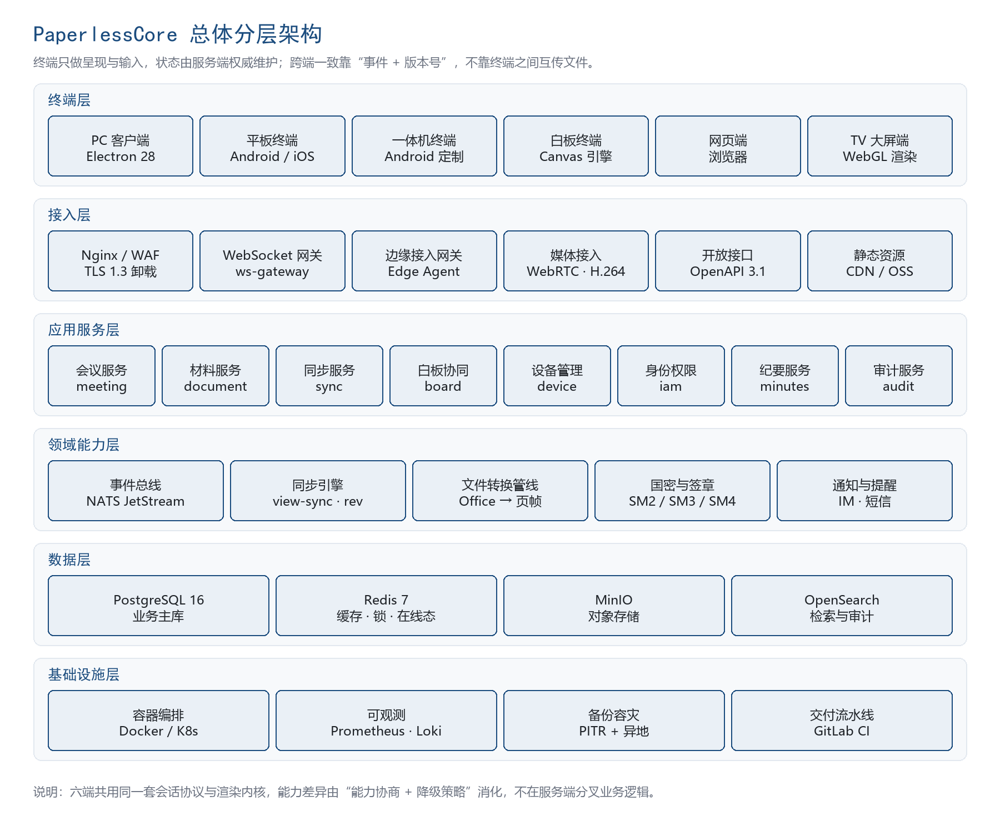
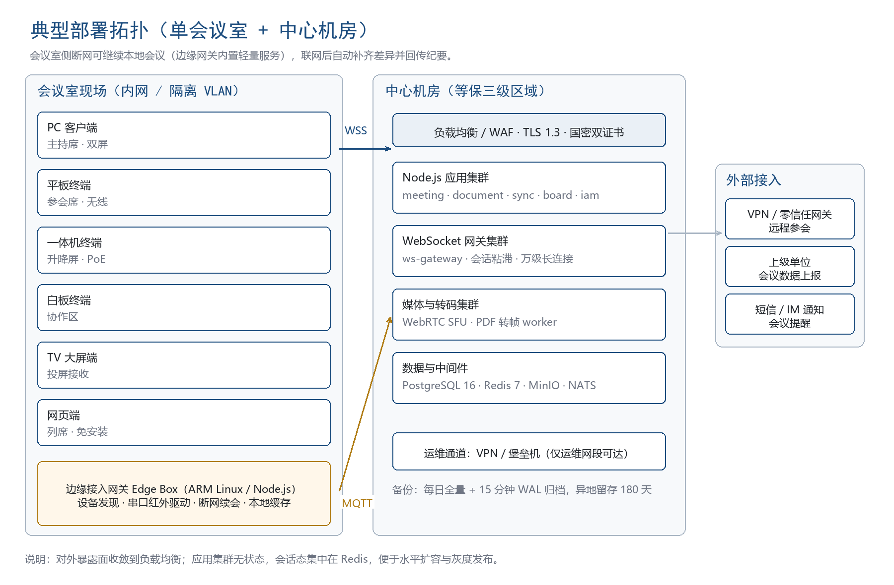
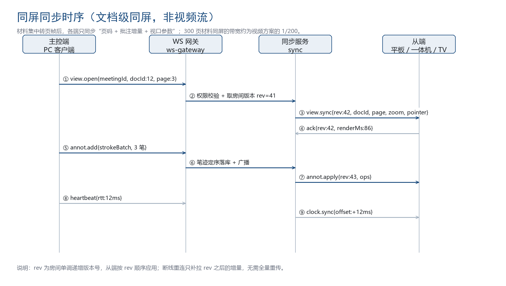

# 1 设计目标与原则

## 1.1 设计目标

系统设计必须同时满足四个目标：六端体验一致、会中状态可信、老设备可接入、运维成本可控。四个目标之间存在张力，例如极致的一致性会抬高老设备门槛，极致的兼容会牺牲新特性。本册通过“服务端权威 + 能力协商 + 分级降级”的组合把张力收敛到可管理范围。

## 1.2 设计原则

- 单一事实来源：会议状态、材料版本、议程顺序只有一份权威数据，位于服务端，任何终端不得自行推断或缓存为可写状态。
- 事件驱动而非轮询：所有实时变化以事件形式广播，事件带版本号，接收方按版本号顺序应用。
- 无状态服务：应用进程不保存会话内存态，会话态集中在 Redis，便于水平扩容与故障切换。
- 失败可恢复：任何一步失败必须能停在可识别状态，重启后能从持久化状态恢复，不出现“半开会”。
- 兼容向下不向上：新能力必须能被老终端安全忽略，老终端不识别的事件直接丢弃而不是报错。
- 默认最小权限：材料可见范围默认为无，由管理员显式授予，授权过期自动回收。

# 2 总体架构

## 2.1 分层结构

系统按六层组织，自上而下为终端层、接入层、应用服务层、领域能力层、数据层、基础设施层。层间只允许相邻依赖，终端层不得直连数据层，应用服务层不得绕过领域能力层直接操作存储。

终端层解决呈现与输入，六端共用同一套会话协议与渲染内核；接入层解决连接、鉴权、限流与协议转换；应用服务层按业务模块组织，每个模块独立部署单元但共享进程；领域能力层沉淀跨模块复用的能力，包括事件总线、同步引擎、文件转换管线、国密与签章、通知；数据层提供关系库、缓存、对象存储与检索；基础设施层负责编排、可观测、备份与交付。

## 2.2 与常见方案的差异

多数同类系统采用“终端之间直接投屏”或“服务端转发屏幕视频”的方案。前者在终端异构时无法保证一致，后者在 100 端规模下带宽与转码成本不可接受。本系统选择第三条路径：材料集中转页帧，服务端只广播视口与批注增量。这一决策（ADR-002）使 300 页材料的同屏带宽从每端 2 Mbps 降至约 10 Kbps 量级。

部署上区分会议室侧与中心机房侧。会议室侧的边缘网关承担设备协议适配与断网续会，中心侧承担材料托管、鉴权与跨会议室协同。两处之间只允许网关主动向中心建立出站连接，避免在会议室防火墙上开口。

## 2.3 进程与部署单元

表 1 部署单元划分

| 单元 | 职责 | 实例数（基准） | 扩容方式 |
| api | 业务接口与编排，REST 主体 | 3 | 无状态水平扩容 |
| ws-gateway | 长连接接入、鉴权、事件路由 | 3 | 按连接数与内存扩容 |
| sync-worker | 房间状态推进、事件定序与广播 | 2 主 2 备 | 按房间分片，一致性哈希 |
| doc-worker | 材料转帧、缩略图、文本抽取 | 4 | 按队列深度扩容 |
| media-worker | 外接信号编码与转发 | 2 | 按并发投屏数扩容 |
| edge-agent | 会议室本地代理 | 每室 1 | 就近部署 |
| web | 管理端与网页端静态资源 | 2 | CDN 或本地缓存 |

# 3 技术选型

## 3.1 选型表

表 2 技术选型与理由

| 层次 | 选型 | 版本 | 选型理由 | 备选与否决原因 |
| 运行时 | Node.js | 22.x LTS | 与前端同语言，I/O 密集场景性能足够，生态成熟 | Go 性能更好但团队栈不一致，学习成本高 |
| 语言 | TypeScript | 5.6 | 严格类型可在接口层拦截大量缺陷 | JavaScript 缺少契约约束 |
| 服务框架 | NestJS | 11 | 模块化、依赖注入、守卫与拦截器生态完善 | Express 过于裸露，Fastify 生态不足 |
| HTTP 适配 | Fastify Adapter | 5 | 吞吐比默认适配器高约 30% | 默认适配器性能偏低 |
| 关系库 | PostgreSQL | 16 | JSONB、行级安全、逻辑复制满足多租户与审计 | MySQL 的 JSON 与分区能力弱 |
| 缓存与会话 | Redis | 7.2 | 房间状态、分布式锁、发布订阅 | Memcached 无数据结构 |
| 对象存储 | MinIO | 近线版本 | 内网自建、S3 兼容、支持桶策略与加密 | 公有云对象存储不合规 |
| 消息总线 | NATS JetStream | 2.10 | 轻量、支持持久化与至少一次投递 | Kafka 运维过重 |
| 设备通道 | EMQX | 5.8 | MQTT 5 支持、百万连接、规则引擎 | 自研 MQTT 风险高 |
| 检索 | OpenSearch | 2.15 | 材料与审计全文检索 | Elasticsearch 许可证风险 |
| 媒体 | WebRTC + H.264 | 标准 | 外接信号投屏延迟低、浏览器原生支持 | 自研编码器成本高 |
| 构建 | pnpm + Turborepo | 最新稳定 | Monorepo 增量构建，六端共享包 | npm workspaces 增量能力弱 |

## 3.2 选型约束

所有选型必须满足三项硬约束：可在内网离线部署、可国产化平台运行、许可证允许政企采购。任何引入公有云依赖或需要外网激活的组件一律不得进入基线。依赖升级遵循“主版本不跨级、次版本季度评估”的节奏，安全补丁随时跟进。

# 4 模块划分

## 4.1 模块清单

表 3 业务模块与职责边界

| 模块 | 职责 | 不负责 | 对外接口前缀 |
| meeting | 会议生命周期、议程、参会名单、开局与结束 | 材料内容、设备控制 | /api/v1/meetings |
| document | 材料上传、转帧、版本、授权、检索、销毁 | 视口同步 | /api/v1/documents |
| sync | 房间、视口事件、指针、批注定序与广播 | 业务规则判定 | /ws/v1 与 /api/v1/rooms |
| board | 白板画布、笔迹、对象、导出 | 材料转换 | /api/v1/boards |
| vote | 签到、表决、评分、结果快照 | 会议状态推进 | /api/v1/votes |
| minutes | 纪要生成、编辑、签审、决议与任务 | 归档存储 | /api/v1/minutes |
| iam | 认证、组织、角色、授权、会话 | 业务权限语义 | /api/v1/iam |
| device | 终端注册、能力集、指令下发、健康监测 | 硬件驱动实现 | /api/v1/devices |
| notice | 站内信、短信、邮件、IM 通知 | 通知内容生成 | /api/v1/notices |
| audit | 操作日志、访问日志、导出留痕 | 业务数据修改 | /api/v1/audits |
| openapi | 对外集成接口与数据上报 | 内部业务实现 | /api/v1/open |

## 4.2 模块依赖规则

模块之间只允许通过三类通道交互：同步调用（仅允许上层模块调用下层模块的公开服务）、领域事件（通过 NATS 发布，事件名形如 document.version.replaced）、共享读模型（只读视图，不允许跨模块写入）。禁止跨模块直接查询对方的数据表，禁止在数据库层面建立跨模块的外键约束，跨模块一致性由事件与补偿任务保证。

## 4.3 代码组织

服务端采用 NestJS 模块化结构，每个业务模块一个目录，内部按 controller、service、domain、repository 四层组织。领域模型不依赖框架装饰器，保证可单测；仓储层封装 Prisma 与 Kysely，复杂查询走 Kysely，简单读写走 Prisma。跨模块共用的类型放在 packages/contracts，由接口契约生成，前后端共用。

# 5 关键流程设计

## 5.1 会议开局

开局是风险最高的动作，涉及状态推进、材料预载校验、终端能力上报、主控权分配。流程为：主持人在任一已登录终端触发开局请求；meeting 模块在单一数据库事务内校验前置条件（材料审签完成、到会率达到阈值、无进行中的表决）；事务提交后发布 meeting.started 事件；sync 模块创建房间并写入初始 rev；ws-gateway 向本会议室全部在线终端推送 room.joined；终端上报能力集，服务端计算降级策略并下发；主持人取得主控权，其余终端进入跟随态。整个过程目标耗时不超过 3 秒，超时则回滚并提示具体阻塞项。

## 5.2 同屏与批注

同屏采用文档级同步，时序如图 3。主控端每次视口变化生成 view 事件，sync 模块在房间内分配 rev 并广播；从端应用后回执渲染耗时，服务端据此统计端到端延迟。批注采用“只追加 + 服务端定序”，笔迹一旦提交不再修改，因此不需要操作变换，仅需去重与顺序保证。

## 5.3 材料转帧

材料上传后进入 doc-worker 队列。处理链为：格式识别、病毒扫描、源文件归档、按类型转换（PDF 直出页帧，Office 与 OFD 经 LibreOffice 或无头转换器输出 PDF 再出帧）、生成多级缩略图、抽取文本入检索、生成页索引、回写版本状态。转换失败不删除源文件，保留失败原因供管理员重试。为控制内存，转换按页流式输出，单进程并发不超过 2 个任务。

## 5.4 断网续会

中心失联时，边缘网关切换为本地模式，保留房间状态与事件队列，终端继续工作。恢复后网关以“事件批次 + 起始 rev”上报，服务端按 rev 合并，冲突按服务端定序裁决，重复事件按幂等键丢弃。离线期间的签到与表决数据单独标记来源为边缘，审计中保留该标记。

## 5.5 会议结束与归档

结束时先冻结过程数据，再生成纪要初稿，最后执行归档与销毁。三步异步执行但状态机保证顺序：冻结后不再接受任何写入事件；纪要生成读取冻结快照；归档将材料转只读并计算内容指纹；销毁按密级策略清理终端缓存与页帧。任何一步失败进入补偿队列重试，重试三次仍失败则告警人工介入。

# 6 数据架构

## 6.1 存储分工

表 4 数据存放位置与理由

| 数据 | 存放 | 理由 |
| 会议、议程、参会、表决、纪要 | PostgreSQL | 需要事务与关系约束 |
| 材料源文件、页帧、缩略图、导出件 | MinIO | 大对象、按桶策略控制访问 |
| 房间状态、在线成员、rev、锁 | Redis | 高频读写、需 TTL |
| 视口与指针轨迹 | Redis 短期 + 归档表 | 实时性高、历史价值低 |
| 批注与白板笔迹 | PostgreSQL + 对象存储 | 需按会议检索与回放 |
| 审计流水 | OpenSearch + 冷备 | 需要全文检索与长期留存 |
| 设备台账与日志 | PostgreSQL + 对象存储 | 结构化查询为主 |

## 6.2 数据流约束

材料正文不得进入日志、消息队列正文与检索快照之外的任何位置；批注与表决数据必须与会议强绑定，会议归档后不可跨会议引用；跨租户数据禁止出现在同一张表的同一分区；所有导出必须经过水印服务并在审计中记录导出人、范围、用途。

## 6.3 容量估算

表 5 基准容量估算

| 指标 | 估算 | 说明 |
| 注册用户 | 20 万 | 单租户最大 5 万 |
| 会议室 | 500 间 | 单会议室终端不超过 30 |
| 峰值在线连接 | 20000 | 500 场 × 平均 40 端 |
| 月新增材料源文件 | 约 1 TB | 按每月 500 场、每场 2 GB 估算 |
| 页帧存储 | 约 120 GB | 按源文件的 12% 估算，保留 30 天 |
| 数据库年增 | 约 300 GB | 含审计与过程数据 |
| 建议存储配置 | 可用 10 TB | 三副本或 RAID6，另配异地备份 |

# 7 接口与协议总览

对外接口分三类：REST 用于配置、查询、上传下载等非实时操作；WebSocket 用于会话内实时事件；MQTT 用于设备指令与状态上报。三类接口共用一套鉴权与错误码，具体契约见第 7 分册。接口版本通过路径前缀区分，v1 生命周期内只增不改，破坏性变更以 v2 并行提供。

# 8 非功能设计

## 8.1 性能设计

性能瓶颈集中在三处：长连接内存、转帧 CPU、广播扇出。长连接采用“每连接轻量上下文 + 共享房间状态”的设计，单连接内存控制在 300 KB 以内；转帧按队列深度弹性扩容，单任务限制 CPU 与内存；广播采用房间内批量编码，同一事件只序列化一次，扇出按终端能力分片推送。

## 8.2 可用性设计

应用层无状态，配合负载均衡实现故障无感切换；sync-worker 采用主备加房间分片，主节点故障时备节点接管分片；Redis 采用哨兵或集群模式；PostgreSQL 采用流复制加自动failover；MinIO 采用多节点纠删码。任一层单点故障不得中断进行中的会议，这是硬性要求。

## 8.3 扩展性设计

新增终端类型只需实现两件事：接入协议适配与能力集声明，业务逻辑不改；新增材料格式只需在 doc-worker 注册转换器；新增业务场景以插件形式挂载到会议模型，不改同步内核。扩展性以 NFR-MTN-01 与 NFR-MTN-02 的工作量指标约束。

# 9 主要风险与权衡

表 6 主要架构风险

| 风险 | 影响 | 应对 |
| 六端一致性难以长期维持 | 联调返工、体验割裂 | 共享内核 + 契约测试 + 视觉走查三重约束 |
| 老设备性能不足导致跟随卡顿 | 试点投诉 | 能力协商与静态帧降级，必要时以边缘网关推流 |
| 断网续会产生数据冲突 | 数据不一致、审计争议 | 服务端定序裁决 + 幂等键 + 边缘来源标记 |
| 材料转帧失败率高 | 会前无法预载 | 多转换器兜底 + 失败可重试 + 会前健康检查 |
| 单体应用随规模膨胀 | 部署与迭代变慢 | 按模块分包，预留拆分边界，规模超阈值再拆 |

权衡结论：在 500 会议室规模内，单体分层的运维成本明显低于微服务，故障定位也更快；一旦单租户超过 500 会议室或需要独立扩容某模块，按第 4 章的模块边界实施拆分，拆分不需要改业务代码，只需改部署单元与事件路由。

# 10 设计结论

本册确立的架构约束在全套文档中生效：状态由服务端权威维护，同屏走文档级同步，实时通道走自研事件协议，材料统一转页帧，老设备经边缘网关与能力降级接入，六端共享渲染内核与设计令牌。上述约束的详细实现分别见第 4、5、6、7 分册。
