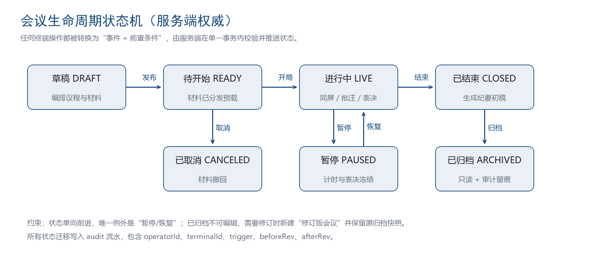

# 1 概述

## 1.1 设计范围

本册覆盖服务端的六个部署单元（api、ws-gateway、sync-worker、doc-worker、media-worker、edge-agent）的模块划分、关键流程、数据模型与算法实现。硬件驱动、终端界面与视觉规范不在本册范围内。

## 1.2 实现基线

服务端统一使用 Node.js 22 LTS、TypeScript 5.6 严格模式、NestJS 11、Fastify 适配器。数据访问采用 Prisma 负责模式与迁移、Kysely 负责复杂只读查询。所有进程以容器方式交付，基础镜像为 distroless，运行用户非 root。

# 2 工程结构

## 2.1 目录组织

工程采用 Monorepo 管理，应用与共享包分离。共享包只放类型、领域模型与协议编解码，不放业务逻辑，避免形成隐式耦合。

```text
paperless/
├── apps/
│   ├── api/                 # 业务接口（REST）
│   ├── ws-gateway/          # 长连接接入与事件路由
│   ├── sync-worker/         # 房间状态机与事件定序
│   ├── doc-worker/          # 材料转帧与文本抽取
│   ├── media-worker/        # 外接信号编码与转发
│   └── edge-agent/          # 会议室边缘代理
├── packages/
│   ├── contracts/           # 由 OpenAPI 与 JSON Schema 生成的类型
│   ├── domain/              # 领域模型与领域服务（无框架依赖）
│   ├── sync-core/           # rev 分配、事件编解码、补拉逻辑
│   ├── design-tokens/       # 设计令牌（六端共用）
│   └── ui-kit/              # 六端共用组件
├── prisma/                  # 模式与迁移
├── deploy/                  # compose、helm、nginx 配置
└── docs/                    # 本套文档
```

## 2.2 模块内部分层

每个业务模块内部固定四层：controller 只做协议转换与参数校验；application 负责用例编排与事务边界；domain 负责业务规则与不变式；repository 负责持久化与查询。领域层不得引入 NestJS 装饰器与 Prisma 类型，保证可脱离框架单测。

# 3 通用机制设计

## 3.1 鉴权链路

请求进入后依次经过四道关卡：TLS 与客户端证书校验（管理端强制双向证书）、令牌解析（JWT，HS256 或国密 SM2 签名）、租户识别（从令牌与网关头双重校验，不一致直接拒绝）、授权决策（RBAC 角色加 ABAC 属性，属性包含会议密级、材料授权、终端类型、时间窗）。授权结果缓存在 Redis，键为 policy:{userId}:{resource}:{action}，过期时间 60 秒，权限变更时按用户广播失效。

## 3.2 多租户隔离

租户通过 tenant_id 字段隔离，所有业务表必须包含该字段并建立复合索引。数据库启用行级安全策略作为兜底，应用层连接时设置 current_tenant 变量，即使应用层遗漏过滤，数据库仍会拦截越权查询。跨租户的运维操作必须走单独的运维连接池，且强制审计。

## 3.3 幂等与去重

所有写接口要求携带 Idempotency-Key，键值由客户端生成（建议 UUIDv7）。服务端在 Redis 中以 SETNX 抢占，有效期 10 分钟，成功后缓存响应体，重复请求直接返回首次结果。实时事件使用 opId 去重，opId 同时写入事件的唯一索引，数据库层面兜底防重。

## 3.4 事务与一致性

单模块内的写操作使用数据库本地事务；跨模块的一致性通过领域事件与补偿任务实现，事件发布采用“本地消息表 + 后台投递”，保证事务提交与事件投递最终一致。不允许使用分布式事务，避免长时间持锁。

## 3.5 限流与背压

入口按租户与接口维度限流，令牌桶算法，配置存于配置中心。广播侧采用背压机制：单连接的发送队列超过 512 条或积压超过 3 秒，服务端主动降级为“仅关键事件”，并下发 sync.degraded 通知终端切换静态模式。

# 4 模块详细设计

## 4.1 会议模块 meeting

### 4.1.1 状态机

会议状态是全局唯一权威，迁移必须写入审计。状态与允许的迁移如下。



表 1 会议状态迁移规则

| 当前状态 | 事件 | 目标状态 | 前置条件 | 副作用 |
| DRAFT | agenda.publish | READY | 议程非空、材料审签完成 | 生成预载任务、发送通知 |
| READY | meeting.start | LIVE | 到会率达到阈值、无进行中表决 | 创建房间、分配主控权 |
| LIVE | meeting.pause | PAUSED | 主持人在线 | 冻结计时与表决 |
| PAUSED | meeting.resume | LIVE | 主持人在线 | 恢复计时 |
| LIVE | meeting.close | CLOSED | 无进行中表决 | 冻结过程数据、生成纪要任务 |
| CLOSED | minutes.signoff | ARCHIVED | 纪要已签审 | 材料转只读、计算指纹 |
| READY | meeting.cancel | CANCELED | 未开局 | 撤回材料授权、通知参会人 |

状态迁移以数据库条件更新实现：UPDATE meeting SET status = $next WHERE id = $id AND status = $current，受影响行数为 0 即视为并发冲突，返回 409 而不是覆盖。

### 4.1.2 核心服务方法

表 2 meeting 模块核心方法

| 方法 | 输入 | 输出 | 说明 |
| create | 会议表单、操作人 | meetingId | 校验时间冲突与权限，写入草稿 |
| publish | meetingId | 预载任务数 | 校验材料与议程，转 READY |
| start | meetingId、操作人 | roomId、rev | 单事务推进状态并创建房间 |
| close | meetingId、操作人 | 冻结快照 ID | 冻结事件流并触发纪要 |
| cancel | meetingId、原因 | 通知结果 | 撤回授权并记录原因 |

## 4.2 材料模块 document

### 4.2.1 转帧管线

材料处理是典型的 CPU 密集异步任务，管线分七个阶段，任一阶段失败保留中间产物并记录阶段名，便于定点重试。

表 3 材料处理阶段

| 阶段 | 处理 | 失败策略 | 耗时目标 |
| ingest | 接收上传、分片校验、计算 SHA-256 | 立即返回失败 | 与文件大小线性 |
| scan | 病毒扫描与文件类型真实性校验 | 隔离文件并告警 | 不超过 20 秒 |
| archive | 源文件写入对象存储、登记版本 | 重试 3 次 | 不超过 10 秒 |
| convert | 转 PDF（Office、OFD）或直出页帧 | 切换备用转换器 | 300 页不超过 25 秒 |
| raster | 生成 1x、2x 页帧与缩略图 | 单页重试，不整体失败 | 每页不超过 120 毫秒 |
| extract | 抽取文本与结构化标题入检索 | 降级为无检索 | 不超过 8 秒 |
| publish | 回写版本可用、广播更新事件 | 重试 3 次 | 不超过 1 秒 |

### 4.2.2 版本与授权

材料版本号以 v1、v2 递增，替换时旧版本状态置为 superseded，页帧保留 24 小时用于追溯，之后回收。授权模型为“授权条目”集合，每条包含主体（人、角色、部门）、客体（材料或议程项）、动作（read、annotate、download）、有效期。授权判定沿“显式授权 → 角色默认 → 会议级默认拒绝”三段落，任一环节命中即返回。

## 4.3 同步模块 sync

### 4.3.1 房间模型

房间是实时会话的容器，键为 room:{meetingId}。房间持有：当前 rev、主控端标识、在线成员表（terminalId 到能力集与连接节点的映射）、当前视口、批注索引、离线标记。房间状态存 Redis，持久化事件写入 Redis Stream 并异步落库。

### 4.3.2 rev 分配与事件定序

rev 是房间内的全序来源。分配必须原子，采用 Redis Lua 脚本同时完成自增与写入，避免“分配成功但写入失败”导致的空洞。

```lua
-- KEYS[1]=room:{id}:rev  KEYS[2]=room:{id}:evt  ARGV[1]=payload
local rev = redis.call('INCR', KEYS[1])
redis.call('XADD', KEYS[2], rev .. '-0', 'p', ARGV[1])
redis.call('EXPIRE', KEYS[1], 86400)
return rev
```

多节点并发时，同一房间的事件写入必须路由到同一 sync-worker 分片（一致性哈希以 meetingId 为键），否则 Lua 原子性只能保证 rev 不重，不能保证广播顺序与落库顺序一致。分片故障时由备份分片接管，接管前先从 Stream 恢复未落库事件。

### 4.3.3 事件信封

所有实时事件使用统一信封，字段固定，禁止各端自定义扩展字段。

```typescript
export interface RoomEvent<T = unknown> {
  v: 1;                 // 协议版本
  rev: number;          // 房间版本号，单调递增
  type: string;         // 形如 view.sync、annot.add
  roomId: string;
  meetingId: string;
  ts: number;           // 服务端毫秒时间戳
  from: string;         // 发起终端 ID，服务端产生的事件为 server
  opId?: string;        // 客户端幂等键
  payload: T;
}
```

### 4.3.4 断线重连与增量补拉

终端重连时携带 lastRev。服务端执行三步：若 lastRev 与当前 rev 差值不超过 2000 且 Stream 仍保留，按 XRANGE 补发增量；若超出保留窗口，下发 view.snapshot 全量快照（当前视口、当前页批注、房间成员）；若房间已结束，返回 meeting.closed 并引导终端进入纪要页。补拉完成前终端处于“同步中”状态，不得接受用户输入，避免本地状态污染。

## 4.4 白板模块 board

白板采用“笔迹为不可变对象、对象集合只追加”的模型。一条笔迹包含笔画 ID、作者、页面、颜色、宽度、采样点数组（含时间与压感）、创建 rev。笔迹一旦提交不再修改，因此合并只需定序与去重，不需要操作变换。橡皮擦不删除笔迹，而是追加一条 erase 操作指向被擦除的笔画 ID，保证可回放与可审计。

表 4 白板对象类型

| 类型 | 说明 | 是否可变 |
| stroke | 手写笔迹 | 不可变 |
| shape | 识别后的图形（矩形、圆、箭头） | 不可变，可追加属性补丁 |
| text | 文本块 | 可变，按 rev 覆盖 |
| image | 图片与页快照 | 不可变 |
| erase | 擦除指令 | 不可变，指向目标 ID |

## 4.5 表决模块 vote

### 4.5.1 幂等计票

计票的正确性依赖两道防线：数据库唯一索引 (vote_item_id, user_id) 保证一人一票；Redis 计数器只用于实时展示，最终结果以数据库明细重算为准。提交路径为：校验签到状态与授权 → 写明细（唯一索引冲突即视为重复提交，返回首次结果）→ 原子自增展示计数 → 广播 vote.tick。计时结束或全员提交后，服务端生成结果快照，快照包含票数、明细摘要、规则参数与内容指纹，指纹用于事后核验。

### 4.5.2 匿名表决

匿名表决下，明细表的 user_id 以“票根”替代：服务端为每位投票人分配随机票根并单独保存映射表，映射表在表决关闭后加密归档，仅审计员在特定审批下可解封。展示与统计只使用票根，避免实时泄露个人意向。

## 4.6 纪要模块 minutes

### 4.6.1 初稿生成

纪要初稿由模板驱动：模板定义章节（会议基本情况、议题与发言、表决结果、决议事项、待办任务）。生成时按议程顺序填充议题标题与绑定材料摘要，按时间轴填充发言要点（来自记录员标注与语音转写，后者为可选能力），按表决快照填充结果表。生成结果标记为“机器初稿”，必须经记录员确认才能进入签审。

### 4.6.2 签审与分发

签审采用多级串行：记录员提交 → 主持人审核 → 机要员核密 → 签发。每一级记录操作人、时间、意见与版本号。签发后纪要转只读，任何修改必须新开修订版本并保留原版本。

## 4.7 设备模块 device

### 4.7.1 能力集与降级策略

终端入会时上报能力集，包含渲染后端（Canvas、WebGL）、最大纹理尺寸、是否支持 WebRTC、是否支持触控笔压感、可用内存档位、屏幕分辨率档位。服务端据此计算降级策略并下发，策略包含页帧分辨率（1x 或 2x）、批注采样率、是否启用实时指针、是否允许本地缓存。

### 4.7.2 指令通道

设备指令经 MQTT 下发，主题设计为 pls/{tenant}/{room}/{terminal}/cmd 与 pls/{tenant}/{room}/{terminal}/evt，QoS 1，指令带超时与重试次数。指令必须幂等，终端按指令 ID 去重。离线终端进入指令队列，上线后按时间顺序补发，过期指令直接丢弃并告知服务端。

## 4.8 身份模块 iam

认证支持本地账号、LDAP/AD、OAuth2、CAS。令牌采用短生命周期访问令牌（15 分钟）加长生命周期刷新令牌（7 天，单次使用并轮换）。管理端强制双因子。会话表记录设备指纹与登录地，异地登录触发提醒并要求二次确认。

## 4.9 审计模块 audit

审计分三类：操作审计（谁改了什么）、访问审计（谁看了什么材料）、导出审计（谁导出了什么、用途）。审计写入采用追加写，应用账号无删除权限，删除能力只授予独立审计账号并需双人复核。审计数据同步至 OpenSearch 供检索，冷数据按月归档至对象存储并保留索引。

# 5 数据模型

## 5.1 表清单

表 5 核心数据表

| 表名 | 说明 | 关键字段 | 关键索引 |
| iam_tenant | 租户 | id、name、status | 主键 |
| iam_org_unit | 组织单元 | id、tenant_id、parent_id、path | (tenant_id, path) |
| iam_user | 用户 | id、tenant_id、account、status | (tenant_id, account) 唯一 |
| iam_role | 角色 | id、tenant_id、code | (tenant_id, code) 唯一 |
| iam_grant | 授权 | id、subject、object、action、expire_at | (subject, object) |
| meeting | 会议 | id、tenant_id、title、status、secret_level、start_at | (tenant_id, start_at)、status |
| agenda_item | 议程项 | id、meeting_id、seq、title、doc_id | (meeting_id, seq) |
| attendee | 参会人 | id、meeting_id、user_id、role、checkin_at | (meeting_id, user_id) 唯一 |
| doc_file | 材料 | id、meeting_id、name、secret_level、status | (meeting_id, status) |
| doc_version | 版本 | id、doc_id、version、sha256、page_count | (doc_id, version) 唯一 |
| doc_page | 页帧 | id、version_id、page_no、object_key、width、height | (version_id, page_no) |
| doc_annotation | 批注 | id、version_id、page_no、user_id、payload | (version_id, page_no) |
| room_event | 事件归档 | id、meeting_id、rev、type、payload、ts | (meeting_id, rev) 唯一 |
| board_stroke | 笔迹 | id、board_id、page_no、author、rev、points | (board_id, page_no) |
| vote_item | 表决项 | id、meeting_id、title、rule、status、deadline | (meeting_id, status) |
| ballot | 票 | id、vote_item_id、user_id、choice、receipt | (vote_item_id, user_id) 唯一 |
| minute | 纪要 | id、meeting_id、version、status、sha256 | (meeting_id, version) |
| terminal | 终端 | id、tenant_id、room_id、model、status | (tenant_id, room_id) |
| audit_log | 审计 | id、tenant_id、actor、action、object、ts | (tenant_id, ts)、action |

## 5.2 分区与归档

room_event 与 audit_log 按月分区，超过保留期自动 detach 并归档至对象存储。doc_page 不分区，按版本级联删除。所有大表禁止使用 SELECT *，查询必须走覆盖索引或投影。

## 5.3 迁移规则

迁移文件按时间戳命名，每个迁移必须提供 up 与 down。破坏性变更分三步实施：先加新列并双写、再切读、最后删旧列，三次变更跨版本发布。禁止在同一迁移中同时改表结构与回填数据。

# 6 关键算法

## 6.1 时钟同步

客户端与服务端通过三次报文估算偏差：客户端发 t0，服务端回 t1 与 t2，客户端收 t3，偏差估计为 ((t1 - t0) + (t2 - t3)) / 2，往返时延为 (t3 - t0) - (t2 - t1)。每 30 秒校准一次，取最近 5 次的中间值抑制抖动。该偏差用于表决计时与笔迹时间轴的显示对齐，不用于业务判定。

## 6.2 事件冲突裁决

同一房间的并发事件由服务端统一分配 rev，天然形成全序，不存在客户端之间的冲突。唯一需要裁决的是离线期间本地产生的事件与中心恢复后的顺序：以服务端 rev 为准，本地事件在恢复后追加到尾部并重新分配 rev，若与已有事件语义重复（同 opId 或同笔迹 ID），丢弃本地副本。

## 6.3 快照生成

全量快照包含：房间当前 rev、视口（文档、页码、缩放、滚动）、当前页批注集合、白板当前页对象集合、成员列表与能力集。快照体积控制在 200 KB 以内，超过时批注与对象只带 ID 列表，由终端按需拉取。

# 7 异步任务与调度

表 6 主要后台任务

| 任务 | 触发 | 频率 | 失败处理 |
| 材料转帧 | 上传事件 | 事件驱动 | 重试 3 次后转人工队列 |
| 预载清单生成 | 会议转 READY | 事件驱动 | 重试 5 次并告警 |
| 纪要初稿生成 | 会议转 CLOSED | 事件驱动 | 重试 3 次 |
| 终端缓存销毁 | 会议归档 | 事件驱动 | 失败终端列入下次开机清理 |
| 设备健康巡检 | 定时 | 每 60 秒 | 连续 3 次失败告警 |
| 审计归档 | 定时 | 每日 02:00 | 失败顺延并告警 |
| 备份校验 | 定时 | 每周 | 失败立即通知运维 |

# 8 可观测性

## 8.1 指标

关键指标分四组：业务指标（进行中会议数、在线终端数、预载完成率）、性能指标（同步延迟分位数、接口 P95、转帧耗时）、资源指标（连接数、内存、队列深度）、质量指标（错误率、转帧失败率、补拉次数）。指标通过 Prometheus 暴露，看板按租户与会议室维度下钻。

## 8.2 日志与追踪

日志为结构化 JSON，必带 traceId、spanId、tenantId、meetingId、terminalId。traceId 由网关生成并透传至所有下游与异步任务，异步任务在消息头携带同一 traceId。日志级别规范：error 只用于需要人工介入的异常，warn 用于自动恢复的异常，info 记录状态迁移，debug 仅开发环境开启。

# 9 异常处理与降级

表 7 降级矩阵

| 异常 | 检测方式 | 降级动作 | 恢复方式 |
| 转帧队列积压 | 队列深度阈值 | 降低页帧分辨率，延后非关键材料 | 队列回落自动恢复 |
| 广播延迟升高 | P95 超过 500 毫秒 | 关闭实时指针，合并视口事件 | 延迟回落后恢复 |
| Redis 不可用 | 健康检查失败 | 房间转只读，禁止写入事件 | 主从切换后重建房间 |
| 数据库主库故障 | 复制延迟与探活 | 切换备库，写操作短暂排队 | failover 完成 |
| 边缘网关离线 | 心跳超时 | 中心侧标记会议室离线，保留房间 30 分钟 | 网关重连后合并 |
| 单终端异常 | 连续心跳丢失 | 标记终端离线，向主持人提示 | 终端重连后补拉 |

# 10 安全实现要点

服务端承担四项安全职责：传输安全、数据安全、水印与防外泄、审计。传输上强制 TLS 1.3，管理端启用双向证书，国密场景下采用 SM2 双证书并按 GB/T 39786 的要求配置；数据上对密级为秘密的材料启用服务端加密存储，密钥由密码机托管，应用只持有密钥句柄；水印由服务端合成，包含姓名、工号、终端、时间，位置按请求随机偏移，防止被固定区域裁剪；审计覆盖全部材料访问与导出，写入即不可删。

需要说明一项能力边界：网页端与浏览器环境无法从技术上完全阻止截屏与录屏，本系统采取的是“提高外泄成本 + 事后可追溯”的策略，即动态水印、禁止选中与复制、截图事件的尽力检测与审计留痕。终端类客户端（PC、平板、一体机）可通过系统级接口实现更强的拦截。

# 11 实现约定

所有服务必须实现 /healthz 与 /readyz 两个探针；所有对外接口必须有 OpenAPI 注解并纳入契约校验；所有后台任务必须支持优雅停机，停机时先停止取任务再等待在途任务完成，最长等待 30 秒；所有定时任务在多副本部署时必须使用分布式锁，避免重复执行。违反上述约定的代码在评审阶段直接退回。
