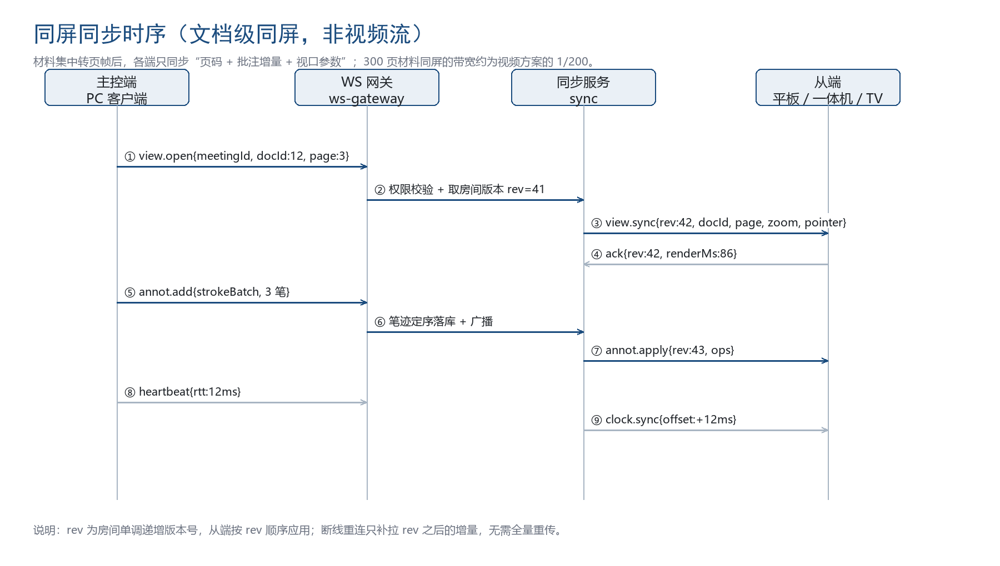
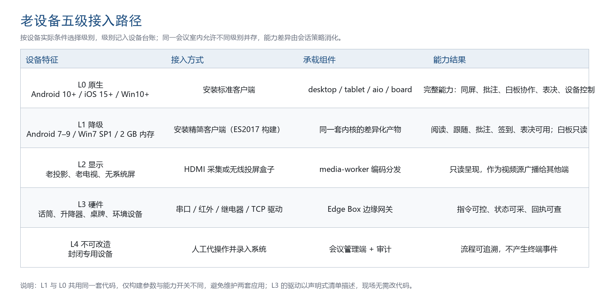

# 1 目标与约束

## 1.1 目标

互操作的目标不是让所有设备功能相同，而是让同一场会议中的每个参与者都能获得“足够用”的体验，并且系统对“谁看到了什么、谁改了什么”有统一记录。因此本册围绕三件事展开：设备如何被识别与授权、状态如何被同步、能力不足时如何体面降级。

## 1.2 约束

现场约束有五条：会议室网络通常与办公网隔离，且不允许会议室主动向办公网发起任意连接；无线网络由单位既有 AP 提供，可能不支持组播；老设备的操作系统版本可能低于任何现代浏览器的支持下限；部分会议硬件（话筒、升降器、桌牌）只有串口或红外接口；施工窗口通常只有半天，不允许大规模更换硬件。

这些约束直接决定了技术路线：以网关为唯一出网点、以注册表替代广播发现、以边缘代理替代硬件改造。

# 2 设备身份与发现

## 2.1 设备标识

每台终端拥有两个标识：设备序列号（出厂固化，不可改）与终端 ID（注册时由服务端分配，形如 t-{roomCode}-{seq}）。业务逻辑只使用终端 ID，序列号仅用于资产管理与换机追溯。终端 ID 与会议室绑定，换会议室需重新绑定并写审计。

## 2.2 发现与注册

表 1 设备发现的三条路径

| 路径 | 适用场景 | 机制 | 时延 |
| mDNS 发现 | 会议室本地网络支持组播 | 终端广播 _pls._tcp，网关应答并提供注册地址 | 3 秒内 |
| 注册表拉取 | 网络关闭组播 | 终端按配置的中心地址轮询待注册列表 | 60 秒内 |
| 扫码绑定 | 临时设备、访客设备 | 管理端生成一次性绑定码，终端扫码 | 即时 |

注册流程为：终端上报序列号、型号、系统版本、能力集 → 网关校验白名单 → 服务端生成终端 ID 并写入台账 → 下发会议室配置与证书 → 终端进入待机页。整个过程在局域网内不超过 8 秒，超时则回退到离线待机页并提示管理员。

## 2.3 证书与信任

终端首次注册时签发设备证书，有效期 1 年，支持在线续期。设备证书用于双向 TLS，防止终端被仿冒接入。证书吊销通过 CRL 分发，网关本地缓存 CRL 并在每次握手时校验。

# 3 会话同步协议

## 3.1 房间与成员

一场会议对应一个房间，房间内成员分为主控端、从端、只读端三类。主控端最多一个，可由主持人移交；从端可主动脱会；只读端（TV、网页列席）不产生写入事件。成员表保存在服务端，终端本地只缓存自己的身份，不缓存全局成员列表，避免成员变化导致状态不一致。

## 3.2 事件类型

表 2 会话事件清单

| 事件 | 方向 | 载荷要点 | 频率上限 |
| room.joined | 服务端下发 | 房间信息、成员摘要、当前 rev | 入会一次 |
| view.sync | 主控端上行，服务端广播 | docId、page、zoom、scroll、pointer | 20 次每秒（合并后） |
| view.snapshot | 服务端下发 | 完整视口与当前页批注 | 补拉或重连 |
| annot.add | 任意端上行，服务端广播 | strokeBatch、page、opId | 30 次每秒 |
| annot.erase | 任意端上行 | 目标 strokeId 列表 | 10 次每秒 |
| board.op | 白板端上行 | 对象增量 | 30 次每秒 |
| vote.tick | 服务端下发 | 实时票数与剩余时间 | 2 次每秒 |
| vote.result | 服务端下发 | 结果快照与指纹 | 一次 |
| sync.degraded | 服务端下发 | 降级原因与建议动作 | 状态变化时 |
| presence | 双向 | 在线、心跳、电量、网络质量 | 10 秒一次 |

## 3.3 版本号与补拉

rev 是同步协议的核心。终端每次收到事件必须校验 rev 连续性，发现跳号立即请求补拉。补拉请求携带 lastRev，服务端按窗口返回增量或快照。这条规则使协议具备三项能力：断线重连不丢事件、乱序到达可检测、重复投递可丢弃。



## 3.4 能力协商

终端入会时在 room.joined 的回执中上报能力集，服务端计算策略后通过 session.policy 下发。能力项与降级动作的对应关系见第 9 章。策略下发的原则是“宁可少给，不可给了做不到”，避免终端收到无法执行的事件而报错。

## 3.5 弱网策略

弱网指丢包率超过 5% 或 RTT 超过 120 毫秒。此时服务端按三档处理：轻弱网合并视口事件为 10 次每秒并关闭实时指针；中弱网降为 5 次每秒且只同步页码；重弱网只保留关键事件（页码、表决、结束通知），批注改为延迟批量提交。终端侧同时把页帧请求从 2x 降为 1x。

# 4 多设备联动场景

## 4.1 典型联动

表 3 联动场景与事件流

| 场景 | 参与端 | 事件流 | 一致性要求 |
| 主持人开局 | PC 主控端、全部从端 | 主持人触发 meeting.start，服务端建房间，广播 room.joined，各端上报能力，下发策略 | 全部端在同一 rev 开始 |
| 主讲同屏 | PC 主控端、从端、TV | view.sync 广播，TV 只应用页码与缩放，忽略指针 | 页码必须一致，指针可缺省 |
| 联合批注 | 主持人 PC、参会平板、白板 | annot.add 双向提交，服务端定序后广播，各端叠加渲染 | 笔迹集合一致，顺序可不同展示 |
| 白板协作 | 白板主、平板、一体机 | board.op 增量同步，白板端负责对象合并与导出 | 对象集合收敛 |
| 表决投屏 | 全部终端、TV | 终端提交 ballot，服务端计票，vote.tick 广播，TV 只显示汇总 | 票数一致，个人选票不外泄 |
| 设备联动 | 一体机、边缘网关 | 服务端下发 lift.up、nameplate.set、env.set，网关经串口执行并回执 | 指令幂等，回执可查 |
| 换人接续 | PC 与备用 PC | 主控权移交事件，原主控降为从端，新主控拉取当前快照 | 同一时刻仅一个主控 |

## 4.2 主控权移交

移交是高风险操作，规则如下：只有主持人角色的终端可发起；移交目标必须在线且能力集支持主控；服务端在同一事务内更新主控标识并广播 host.changed；原主控端立即进入跟随态并从当前视口对齐；若目标端在 5 秒内未确认，移交回滚到原主控。这条回滚规则避免了“主控悬空”导致会议无法继续。

## 4.3 与外部系统的联动

与视频会议系统联动时，本系统只推送会议信息与入会链接，不接管音视频流；与 OA 联动时，会议纪要作为附件回传，任务作为待办下发；与门禁联动时，签到时同步开门权限，会结束后自动收回。所有联动均通过开放接口完成，不允许直连对方数据库。

# 5 同屏的三类通道

## 5.1 通道对比

表 4 同屏通道对比

| 通道 | 原理 | 延迟 | 画质 | 依赖 | 适用 |
| 文档级同屏 | 同步页码、缩放、批注增量，各端本地渲染 | 300 毫秒以内 | 无损 | 材料已转页帧 | 自有材料 |
| 客户端软件投屏 | 主控端采集屏幕，WebRTC 编码传输 | 300 至 500 毫秒 | 受码率限制 | 需装客户端 | 第三方应用演示 |
| 无线投屏盒子 | 接收 Miracast、AirPlay、Cast，输出 HDMI 后采集编码 | 100 至 300 毫秒 | 受采集与编码限制 | 需硬件盒子 | 访客自带设备 |
| 有线 HDMI 采集 | 采集卡输入，编码后分发 | 100 毫秒以内 | 高 | 需布线 | 固定会议室 |

## 5.2 选择原则

自有材料一律走文档级同屏，这是本系统的主通道，也是带宽最优解。第三方演示优先走客户端软件投屏，避免访客安装驱动。访客设备无法安装客户端时走无线投屏盒子。对延迟极敏感的演示（如实时操作软件）走有线 HDMI。三条视频通道共用 media-worker，输出统一为 H.264，按终端能力提供 1080p 与 720p 两档。

## 5.3 视频通道的技术要点

编码采用 H.264 baseline 加 profile-level-id 约束，保证老设备可解码；关键帧间隔 2 秒，丢包时依靠 NACK 与 PLI 快速恢复；码率自适应按接收端反馈调整，最低降至 1 Mbps 保证可读；音频默认不传输，避免会议室啸叫，需要时单独开启并做回声抑制。

# 6 白板协同

## 6.1 数据模型

白板以“页面 + 对象集合”组织，对象包括笔迹、图形、文本、图片、擦除指令。笔迹为不可变对象，分段提交：每 64 个采样点或每 200 毫秒提交一段，段内点序固定。这样既降低了单次消息体积，也避免了长笔迹在弱网下丢失。

## 6.2 合并规则

由于对象只追加，合并只需三步：按 rev 排序、按对象 ID 去重、按擦除指令过滤。擦除不删除对象，而是追加 erase 记录，渲染时跳过被擦除对象。该模型带来两个好处：回放可以完整还原过程；离线合并时不会出现“擦除丢失导致笔迹复活”。

## 6.3 性能控制

单页对象上限为 5000 个，超过后提示新建页面；单条笔迹采样点上限 2000，超过自动分段；渲染采用脏矩形重绘，只重绘变化区域；四端同时书写时，服务端按 30 次每秒合并广播，超出频率的笔迹段进入下一批。

# 7 时钟同步与倒计时

表决与议程计时对时间一致性要求高。系统采用应用层时钟同步：终端每 30 秒与服务端交换三次报文，估算偏差与 RTT，取最近 5 次的中间值。倒计时以服务端的截止时间戳为准，终端用本地时钟加偏差渲染，因此各端显示的剩余时间偏差不超过 50 毫秒。倒计时归零由服务端判定并广播 vote.closed，终端不以本地归零作为结束依据，避免终端时间被篡改导致结果争议。

# 8 老设备接入方案

## 8.1 五级接入路径

老设备不可能用一套方案覆盖，系统定义五级路径，实施时按设备实际情况选择，并在台账中标注级别。



表 5 五级接入路径说明

| 级别 | 设备特征 | 接入方式 | 能力结果 | 改造成本 |
| L0 原生 | Android 10 及以上、iOS 15 及以上、Windows 10 及以上 | 安装标准客户端 | 完整能力 | 无 |
| L1 降级 | Android 7 至 9、Windows 7 SP1、内存 2 GB | 安装精简客户端，关闭 WebRTC，页帧 1x，笔迹降采样 | 阅读、跟随、批注、签到、表决可用，白板只读 | 无硬件改造 |
| L2 显示 | 老投影、老电视、无系统的显示设备 | HDMI 采集或投屏盒子接收，编码后作为视频源分发 | 只读呈现 | 需采集或盒子 |
| L3 硬件 | 话筒、升降器、电子桌牌、环境控制 | 边缘网关经 RS-232、RS-485、红外、继电器、TCP 驱动 | 指令可控、状态可采 | 需网关与接线 |
| L4 不可改造 | 完全封闭的专用设备 | 保持原状，由人工在系统中代操作并记录 | 流程可追溯 | 无 |

## 8.2 边缘网关

网关是老的硬件体系与新系统之间的翻译层。硬件规格为 ARM64 四核、2 GB 内存、64 GB 存储、双网口、2 路 RS-485、1 路 RS-232、红外收发、4 路 GPIO、支持 PoE。软件为 Node.js 代理，容器化部署，内置本地房间服务，可在与中心失联时独立运行 30 分钟。

表 6 网关职责

| 职责 | 说明 |
| 协议适配 | 加载驱动清单，将统一指令翻译为串口、红外或 TCP 报文 |
| 设备发现 | 串口枚举、红外学习、网段扫描，生成设备清单上报 |
| 状态采集 | 轮询设备状态（升降高度、桌牌在线、环境温湿度）并上报 |
| 本地续会 | 中心失联时接管房间，缓存事件与签到数据 |
| 差量上报 | 恢复后按 rev 上报缓存事件，冲突交由服务端裁决 |
| 安全 | 只主动向中心建立出站连接，本地不开放入站端口 |

## 8.3 驱动模型

驱动以声明式清单描述，运维不需要改代码即可接入新硬件。清单包含厂商、型号、协议类型、指令映射与校验规则。

```json
{
  "vendor": "示例厂商",
  "model": "LIFT-2000",
  "protocol": "rs485",
  "serial": { "baud": 9600, "dataBits": 8, "stopBits": 1, "parity": "none" },
  "capabilities": ["lift.up", "lift.down", "lift.stop", "lift.status"],
  "commands": {
    "lift.up":   { "frame": "A1 01 01 A3", "expect": "A1 01 01 A3 0D" },
    "lift.down": { "frame": "A1 01 02 A4", "expect": "A1 01 02 A4 0D" },
    "lift.status": { "frame": "A1 02 00 A3", "parse": "hex:height" }
  },
  "timeoutMs": 800,
  "retry": 2
}
```

统一指令模型保证业务层不需要理解硬件差异：设备能力被抽象为升降、桌牌、音量、环境、电源五类动作，服务端只下发动作名与参数，网关负责翻译与重试。

## 8.4 降级客户端

L1 级客户端不是新写一套应用，而是同一套代码的差异化构建：编译目标降为 ES2017，禁用 WebAssembly 与 WebRTC，页帧只用 1x，笔迹采样率降为 30 点每秒，动画降为无动画。功能入口按能力集隐藏而不是报错，用户看到的是“该设备不支持白板协作”，而不是“功能异常”。

# 9 兼容矩阵与降级策略

## 9.1 兼容矩阵

表 7 兼容矩阵

| 平台 | 版本 | 接入级别 | 关键限制 |
| Windows | 10 1809 及以上 | L0 | 需 .NET 4.8 运行时 |
| Windows | 7 SP1 | L1 | 无 WebRTC，页帧 1x，禁用水印叠加的硬件加速 |
| macOS | 12 及以上 | L0 | 需授权屏幕录制 |
| 麒麟 V10 | SP1 及以上 | L0 | ARM64 与 x86 分别构建 |
| 统信 UOS | 20 及以上 | L0 | 同上 |
| Android | 10 及以上 | L0 | 需前台服务保活 |
| Android | 7 至 9 | L1 | 无 WebRTC，笔迹降采样 |
| iPadOS | 15 及以上 | L0 | 需引导式访问模式 |
| Chrome、Edge | 95 及以上 | L0（只读） | 不支持本地上传 |
| 国产浏览器 | 基于 Chromium 86 及以上 | L1（只读） | 关闭实时指针 |
| Android TV | 9 及以上 | L0（只读） | 仅全屏展示 |

## 9.2 降级策略

表 8 降级触发与动作

| 能力项 | 触发条件 | 降级动作 | 用户可见提示 |
| 实时指针 | FPS 低于 24 或弱网 | 关闭指针同步 | 无提示，避免干扰 |
| 2x 页帧 | 内存不足或弱网 | 使用 1x 页帧 | 无提示 |
| 白板协作 | 设备不支持压感或内存不足 | 白板转只读 | 工具条置灰并说明 |
| WebRTC 投屏 | 无 WebRTC 或编码能力不足 | 转为视频流的低帧率模式 | 提示“当前设备使用兼容模式投屏” |
| 本地缓存 | 存储低于 200 MB | 仅缓存当前议程材料 | 进入会议时提示一次 |
| 离线续会 | 网关离线 | 仅保留只读与本地批注 | 顶部显示“离线模式” |

# 10 现场实施要点

## 10.1 网络

会议室建议独立 VLAN，终端与网关同网段，网关具备到中心 443 的单向出站权限。无线网络使用 5 GHz 频段，单 AP 承载终端不超过 20 台，关闭无线终端的省电模式，开启 802.11k 与 802.11v 以改善漫游。若 AP 不支持组播，必须改用注册表拉取方式，否则设备发现会失败。

## 10.2 供电与布线

一体机采用 PoE 供电时需确认交换机单口功率不低于 30 瓦；升降器与桌牌走独立 12 伏回路，避免与终端共用电源导致重启；RS-485 总线长度不超过 1200 米，终端电阻按规范配置；HDMI 采集线缆不超过 15 米，超长需使用光纤 HDMI。

## 10.3 调试顺序

现场调试按固定顺序执行，跳步是现场故障的主要来源：先验证网关到中心的连通性与证书，再验证终端注册与待机页，再验证材料预载，然后验证同屏与批注，最后验证设备指令与联动。每一步都有明确的通过标准，未通过不得进入下一步。

# 11 验收与常见问题

## 11.1 接入验收用例

表 9 老设备接入验收用例

| 编号 | 用例 | 通过标准 |
| AC-01 | L1 级 Windows 7 终端入会 | 8 秒内进入待机页，可阅读与跟随，批注延迟不超过 200 毫秒 |
| AC-02 | Android 7 平板断网 10 分钟后恢复 | 自动补拉，视口与批注与服务端一致 |
| AC-03 | 通过网关控制升降器上升 | 指令 1 秒内执行，回执可查，失败重试不超过 2 次 |
| AC-04 | 无线投屏盒子接入访客设备 | 5 秒内出画面，延迟不超过 300 毫秒，1080p 可读 |
| AC-05 | 老投影经 HDMI 采集作为从端 | 画面与主控端页码一致，无花屏与撕裂 |

## 11.2 常见问题

设备发现失败的常见原因是组播被 AP 禁用或终端与网关不在同一网段；同屏不同步的常见原因是终端时钟偏差过大或 rev 跳号未被检测；批注丢失的常见原因是弱网下未做分段提交；设备指令无响应的常见原因是串口参数不匹配或总线终端电阻缺失。上述四类问题在实施手册中均有排查步骤，现场不得凭经验直接更换硬件。
