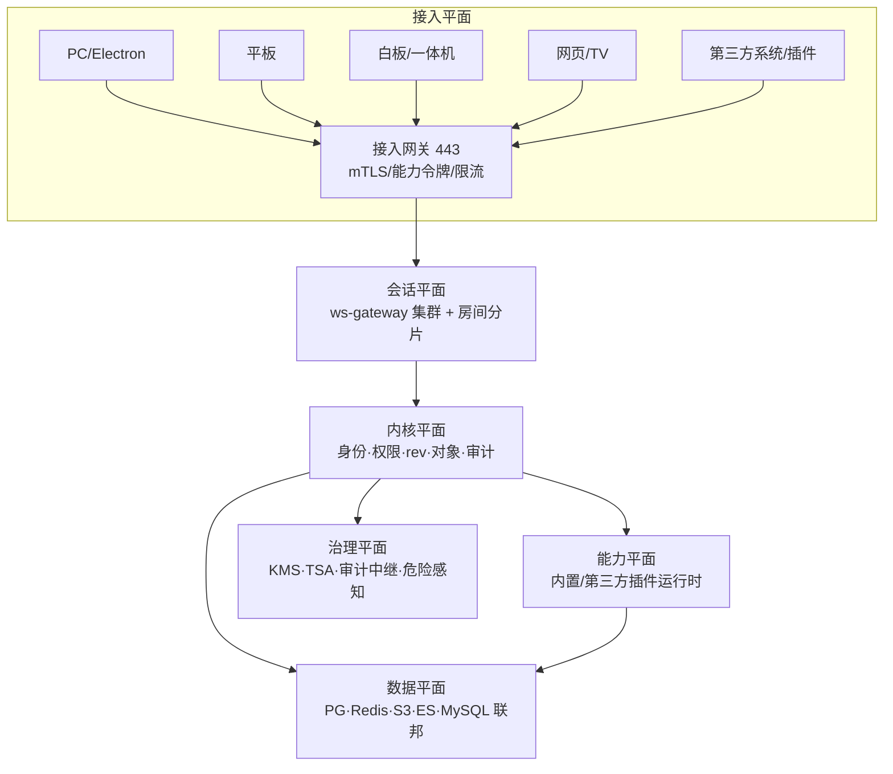

# 03 总体架构与六端

## 3.1 架构总览

平台按「五平面 + 一治理」组织。平面之间只通过契约通信，任意平面可独立替换。

| 平面 | 职责 | 扩展方式 |
| --- | --- | --- |
| 接入 | 接入认证、协议终结、限流、终端指纹 | 加节点（无状态） |
| 会话 | 长连接、房间事件定序与广播 | 按 roomId 分片 |
| 内核 | 身份、权限、版本、对象、审计钩子 | 单写者，垂直扩展 |
| 能力 | 业务功能，全部插件化 | 加插件实例 |
| 数据 | 存储与索引 | 按租户/时间分区 |
| 治理 | 密钥、时间戳、审计、风险 | 独立部署，物理隔离 |

## 3.2 六端共同的内核

六端不是六套 UI，而是**一套渲染内核 + 六套外壳**。渲染内核负责：页帧渲染、批注图层、笔迹图层、事件应用、离线队列、水印。外壳负责：窗口管理、系统能力、输入设备、更新。

这样做的收益是三件：同一份材料在六端像素级一致；新增一种终端只需接外壳；缺陷只需修一处。

代价是渲染内核必须极度克制：不允许包含任何终端特有逻辑（例如「PC 才有双屏」），一切差异通过「能力声明」注入。

## 3.3 PC 端

| 项 | 设计 |
| --- | --- |
| 外壳 | Electron 28，Windows/macOS/Linux/国产化 |
| 典型场景 | 主持人主控、参会人阅读批注、材料准备、纪要编写 |
| 独有能力 | 双屏（主屏材料 + 副屏备注）、本地文件拖入、系统级水印、全局快捷键、离线缓存 300 页 |
| 性能预算 | 冷启动 ≤ 4 秒，翻页 ≤ 60 毫秒，首屏内存 ≤ 350 MB |
| 特殊约束 | 主进程不驻留材料明文；退出即清缓存密钥 |

双屏是 PC 端最有价值的能力，但也是最容易做错的地方：副屏不是「再来一个窗口」，而是「同一会话的第二视图」。副屏必须与主屏共享 rev，否则演讲者看到的备注和观众看到的材料会错位。

## 3.4 平板端

| 项 | 设计 |
| --- | --- |
| 外壳 | Capacitor 6，Android 10+ / iOS 14+ / 鸿蒙兼容层 |
| 典型场景 | 移动参会、手写批注、签到、表决 |
| 独有能力 | 压感笔迹（4096 级）、离线整场缓存、二维码签到、指纹/人脸解锁 |
| 性能预算 | 笔迹延迟 ≤ 30 毫秒（本地预测渲染，服务端确认后校正） |
| 特殊约束 | 切后台超过 5 分钟必须重新鉴权；截屏触发水印并上报事件 |

笔迹必须「本地先画、服务端后定序」。若等服务器确认再落笔，延迟不可接受；若只本地画不同步，多人白板会出现分叉。做法是本地预测 + 单调递增的本地序号 + 服务端定序后按 `opId` 去重与重排。

## 3.5 白板端与一体机端

两者硬件相近但用途不同，共用一套「大屏内核」，差异在交互模式。

| 项 | 白板端 | 一体机端 |
| --- | --- | --- |
| 形态 | 会议白板、书写墙 | 桌面终端、升降屏、桌牌一体 |
| 输入 | 多点触控 + 电磁笔 + 手势 | 触控 + 实体按键 + 刷卡 |
| 模式 | 全屏书写、无限画布、多人协同 | Kiosk 锁定、单应用、开机即入会 |
| 独有能力 | 无限画布、投屏接收、区域放大 | 刷卡签到、桌牌显示、话筒/升降联动、PoE 供电 |
| 约束 | 禁止弹出系统 UI；断网可继续书写 30 分钟 | 禁止安装第三方应用；远程配置下发 |

一体机端的关键不是软件而是**运维**：几百台设备分布在不同楼层，必须支持批量配置、远程重启、固件与版本一致性检查。平台为此提供设备影子（desired state）机制：服务端保存每台设备应有的配置，设备定期上报实际状态，差异自动修复。

## 3.6 网页端与 TV 端

网页端承担三个角色：免安装参会、外部协作方接入、TV 大屏只读。

| 模式 | 能力 | 限制 |
| --- | --- | --- |
| 完整模式 | 阅读、批注、表决、投票、聊天 | 需终端白名单 + 双因子 |
| 访客模式 | 只读指定材料、限时 | 禁止下载、强制水印、到期失效 |
| TV 模式 | 只读大屏、跟随主控 | 无输入、字号放大 1.5 倍、安全区适配 |

TV 端必须单独设计排版：1080p 电视在 3 米观看距离下，正文最小 24 px；安全区留边 5%；禁止滚动长文，材料必须分页。把 PC 页面直接投到电视上是最常见的体验事故。

## 3.7 六端能力矩阵

| 能力 | PC | 平板 | 白板 | 一体机 | 网页 | TV |
| --- | --- | --- | --- | --- | --- | --- |
| 材料阅读 | 全 | 全 | 全 | 全 | 全 | 只读 |
| 手写批注 | 鼠标/笔 | 压感 | 压感 | 触控 | 鼠标 | 无 |
| 同屏主控 | 是 | 是 | 是 | 是 | 是 | 否 |
| 投屏接收 | 是 | 是 | 是 | 是 | 是 | 是 |
| 投屏发起 | 是 | 是 | 是 | 否 | 是 | 否 |
| 视频会议 | 是 | 是 | 是 | 是 | 是 | 只收 |
| 表决 | 是 | 是 | 是 | 是 | 是 | 展示 |
| 预下载缓存 | 2 GB | 4 GB | 网关 64 GB | 网关 64 GB | 浏览器配额 | 跟随网关 |
| 资源叠放层数 | 5 | 3 | 4 | 3 | 3 | 2 |
| 离线续会 | 300 页 | 全场 | 30 分钟 | 30 分钟 | 否 | 否 |
| 系统水印 | 是 | 是 | 是 | 是 | 叠加 | 叠加 |
| 自动更新 | 是 | 应用市场 | 远程 | 远程 | 无需 | 无需 |

## 3.8 部署形态

平台提供三档部署，代码同一套，靠配置切换。

| 档位 | 适用 | 拓扑 | 容量上限 |
| --- | --- | --- | --- |
| 单机档 | 单单位、≤ 50 会议室 | 一台服务器跑全部容器 | 500 并发终端 |
| 标准档 | 集团总部、≤ 500 会议室 | 3 应用节点 + 数据库主备 + 对象存储 4 节点 | 20000 连接 |
| 集群档 | 多组织、跨地域 | 控制面 3 节点 + 数据面按区域分片 + 联盟网关 | 10 万级连接 |

控制面与数据面必须分离。控制面（身份、租户、插件注册、策略）变化少、要求强一致；数据面（房间、材料、事件）变化快、要求高吞吐。混在一起会导致「改个策略把会议搞挂」。

## 3.9 容量与性能预算

| 指标 | 目标 | 测算依据 |
| --- | --- | --- |
| 单房间终端 | 200 | 一场全员大会的典型上限 |
| 单节点长连接 | 8000 | 单连接约 40 KB 内存，留 30% 余量 |
| 同屏延迟 P95 | ≤ 300 毫秒 | 事件广播 + 客户端应用 |
| 事件吞吐 | 单房间 200 事件/秒 | 200 人同时翻页的极端值 |
| 材料转帧 | 100 页/分钟/实例 | LibreOffice 无头转换实测口径 |
| 检索响应 | P95 ≤ 500 毫秒（10 万文档） | 索引分片 + 缓存 |

这些数字不是装饰，它们直接决定第 12 章的扩容阈值与第 09 章的索引策略。

## 3.10 关键决策（ADR 摘要）

| 编号 | 决策 | 代价 |
| --- | --- | --- |
| ADR-101 | 微内核 + 插件，而非单体模块化 | 插件沙箱有性能损耗，需 IPC 优化 |
| ADR-102 | 同屏以文档级事件为主，视频级为辅 | 无法覆盖「任意第三方应用画面」的细粒度同步，需靠采集通道 |
| ADR-103 | 终端不持有可写状态 | 弱网体验依赖队列，需精心设计重试 |
| ADR-104 | 元数据 PG、业务数据联邦 | 跨库事务不可用，须以最终一致换弹性 |
| ADR-105 | 审计哈希链外挂时间戳 | 增加外部依赖，需离线兜底 |
| ADR-106 | 加密按组织域分层（租户/部门/小组） | 密钥数量增长，需 KMS 分层管理 |

---

下一章：`04_插件化接入体系.md`
