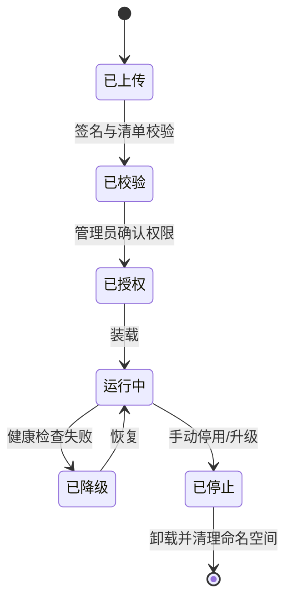

# 04 插件化接入体系

## 4.1 为什么用插件

客户差异不是「多几个按钮」，而是三类结构性问题：**数据源不同**（医院 HIS、学校教务、企业 ERP）、**流程不同**（党委会与董事会规则不一样）、**硬件不同**（各家的升降、话筒、桌牌协议都不一样）。用一支主干代码应对这三类差异，必然变成「一堆 if（客户名）」。

插件体系要解决的就是这件事：把差异收敛到可独立交付、可独立升级、可独立卸载的单元，且**不牺牲内核的稳定性**。

## 4.2 插件五种类型

| 类型 | 运行位置 | 能力 | 典型用例 |
| --- | --- | --- | --- |
| 服务插件（service） | 服务端沙箱进程 | 提供 REST/事件、读写被授权的数据 | 财务对接、HIS 对接、审批流 |
| 协议插件（protocol） | 边缘网关或服务端 | 把外部协议翻译成平台事件 | 话筒/升降/桌牌、传统会议系统 |
| 数据源插件（source） | 服务端沙箱 | 接入外部库并映射为联邦视图 | MySQL、NAS、Excel、LDAP |
| 界面插件（ui） | 终端渲染层 | 在主界面挂载区域，渲染自定义内容 | 企业私有网页、小程序、行业面板 |
| 驱动插件（driver） | 边缘网关 | 设备发现、指令编解码 | 串口、红外、GPIO、Modbus |

五类共用同一套 manifest 与权限模型，但沙箱强度不同：服务/数据源插件跑在独立进程，界面插件跑在受限 iframe，驱动插件跑在边缘网关的最小运行时。

## 4.3 manifest 契约

```json
{
  "id": "com.example.finance-bridge",
  "version": "1.2.0",
  "type": "service",
  "contractVersion": "2.0",
  "displayName": "财务凭证桥接",
  "vendor": { "name": "Example Inc", "contact": "dev@example.com" },
  "entry": "dist/index.js",
  "supports": { "kernel": ">=2.0 <3.0", "platform": ["linux-x64"] },
  "capabilities": [
    { "name": "finance.voucher.push", "kind": "command", "schema": "contracts/finance/voucher.json" },
    { "name": "finance.reconcile.daily", "kind": "job", "cron": "0 2 * * *" }
  ],
  "permissions": {
    "storage": ["namespace:finance"],
    "events": { "subscribe": ["meeting.closed"], "publish": ["finance.voucher.created"] },
    "http": { "egress": ["https://erp.example.com"], "methods": ["POST"] },
    "secrets": ["finance.apiKey"]
  },
  "resources": { "cpu": 1, "memoryMb": 512, "timeoutMs": 30000 },
  "ui": null
}
```

四条硬规则：

1. `capabilities` 里的每个名字都必须能从 `contracts` 找到 schema，找不到的插件不允许加载。
2. `permissions` 是白名单，未声明即拒绝。运行时无法通过任何方式扩大自己的权限。
3. `resources` 必须有上限，防止一个插件拖垮整台机器。
4. `contractVersion` 与内核做交集校验，不兼容则拒绝加载并告警，绝不放行后崩溃。

## 4.4 生命周期



关键设计：**装载失败不影响主流程**。任何插件异常，内核只做两件事——记录、降级。会议照常开，功能缺失以「不可用」呈现，而不是抛出 500。

## 4.5 沙箱与隔离

| 隔离维度 | 做法 |
| --- | --- |
| 进程 | 每个服务插件独立子进程，崩溃不传染 |
| 内存 | 设定 RSS 上限，超限触发 OOM 保护并重启 |
| 文件 | 只挂载自己的命名空间目录，只读挂载公共资源 |
| 网络 | 默认无出网；出网需在 `permissions.http.egress` 声明域名，由代理转发 |
| 密钥 | 只能通过 SDK 取用已声明的 secret，拿不到明文，只能拿到使用结果 |
| 数据 | 只能读写自己命名空间的表，跨域读写必须走内核 API |

对「插件要访问业务数据」这类常见诉求，正确做法不是给数据库连接串，而是给**能力接口**：内核暴露 `meeting.readSummary` 之类受控方法，插件调用它，内核负责鉴权与审计。这样插件永远看不到超出授权的数据。

## 4.6 企业私有网页 / 小程序的接入

企业往往已有内部系统（报销、工单、党建、教务），希望嵌进会议界面。平台提供「界面插件」形态：

| 环节 | 机制 |
| --- | --- |
| 挂载 | 主界面预留 `slot`（如 `meeting.sidebar`、`material.toolbar`），插件声明占用哪个 slot |
| 渲染 | 受限 iframe，`sandbox="allow-scripts allow-same-origin"`，禁用顶层跳转与弹窗 |
| 通信 | `postMessage` + 双方握手，消息体走 JSON-RPC，每条消息带 `traceId` |
| 鉴权 | 主应用下发短期会话票据（5 分钟），iframe 用它换业务令牌，禁止长期凭证进入 iframe |
| 尺寸 | 主应用下发容器尺寸与主题令牌，iframe 自适应，禁止自行改窗口 |
| 审计 | 所有跨边界消息按事件记录，可回放 |

握手协议三步：iframe 就绪后发 `ui.ready`，主应用回 `ui.init`（带票据、主题、能力清单），iframe 回 `ui.mounted`。三步未完成则 3 秒后显示降级占位。

必须承认的限制：iframe 内的第三方页面若自身存在 XSS，平台无法替它兜底。因此企业私有页面接入前必须通过平台的安全扫描，并在契约中约定不得读取宿主 DOM。

## 4.7 插件注册与分发

| 场景 | 方式 |
| --- | --- |
| 官方插件 | 随镜像分发，签名校验后自动装载 |
| 客户定制插件 | 私有仓库，管理员上传包，平台校验签名与清单 |
| 离线环境 | U 盘导入 `.plg` 包，导入时做离线签名校验 |
| 灰度 | 按租户/部门灰度，可按百分比 |
| 回滚 | 保留上一版本包，一键回退 |

`.plg` 包结构固定：`manifest.json`、`dist/`、`contracts/`、`signature.sig`、`README.md`。缺失任一项拒绝导入。

## 4.8 插件示例

```ts
import { definePlugin, z } from '@paperless/plugin-sdk';

export default definePlugin({
  id: 'com.example.finance-bridge',
  async onLoad(ctx) {
    ctx.logger.info('finance plugin loaded', { tenant: ctx.tenantId });
  },
  commands: {
    'finance.voucher.push': {
      input: z.object({ meetingId: z.string(), amount: z.number().positive() }),
      async handler(input, ctx) {
        const meeting = await ctx.kernel.meeting.summary(input.meetingId);
        if (!meeting) throw ctx.error('FIN_MEETING_NOT_FOUND', 404);
        const voucher = await ctx.http.post('https://erp.example.com/api/voucher', {
          body: { title: meeting.title, amount: input.amount },
          headers: { Authorization: `Bearer ${await ctx.secrets.use('finance.apiKey')}` },
          timeoutMs: 5000,
        });
        await ctx.audit.record('finance.voucher.created', { voucherId: voucher.id });
        return { voucherId: voucher.id };
      },
    },
  },
  async onUnload(ctx) {
    await ctx.storage.flush();
  },
});
```

注意 `ctx.secrets.use` 返回的是**使用凭据**而非明文；`ctx.http` 只能访问清单里声明的域名；`ctx.audit.record` 会把动作写进哈希链。

## 4.9 插件治理

| 风险 | 控制 |
| --- | --- |
| 插件拖慢全局 | 资源上限 + 熔断（第 12 章） |
| 插件泄露数据 | 能力接口 + 出网白名单 + 审计 |
| 插件版本混乱 | 契约版本 + 兼容矩阵 + 灰度 |
| 插件作者跑路 | 源码托管 + 构建可复现 + 包签名 |
| 插件数量膨胀 | 每租户插件数上限 + 冷启动按需装载 |

## 4.10 什么时候不该用插件

插件不是万能药。以下三种情况应直接写进内核或独立服务：

1. **性能敏感路径**（同屏广播、翻页、笔迹定序），多一跳 IPC 就是几十毫秒。
2. **强一致要求**（权限判定、密钥使用），必须在内核内完成，不能外包。
3. **与生命周期强耦合**（会话建立、终端鉴权），插件挂掉会导致无法开会。

判断标准很简单：**如果这个功能挂了，会议还能不能开？** 能开就做插件，不能开就必须在内核。

---

下一章：`05_多设备联动与投屏远程控制.md`
