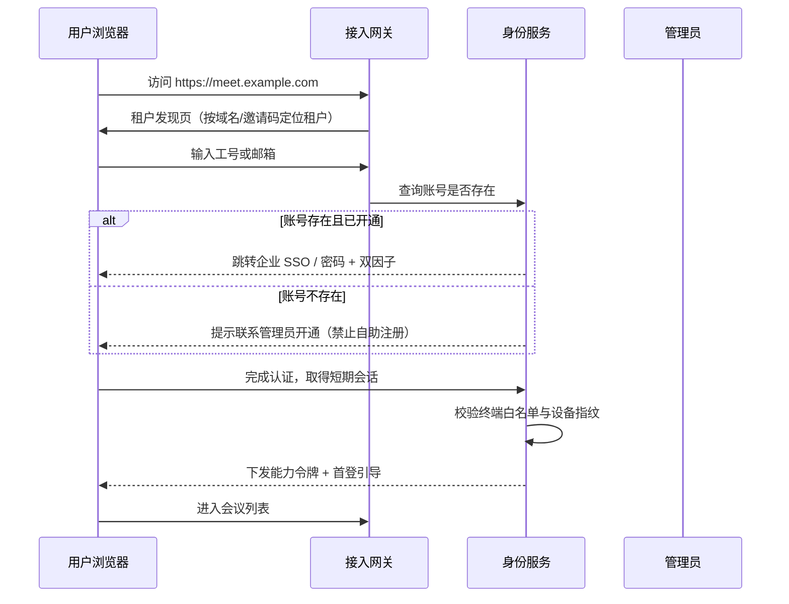

# 07 身份、注册与信任

## 7.1 身份体系的三层

| 层 | 实体 | 作用 |
| --- | --- | --- |
| 租户（Tenant） | 一个单位或一个独立部署 | 数据与密钥的隔离边界 |
| 组织域（Org） | 部门、子公司、项目组，可嵌套 | 权限与加密的继承边界 |
| 用户（User） | 自然人 | 最小授权单位 |

三者关系是：租户 > 组织域（树） > 用户。密钥与权限都沿这棵树继承，子域默认继承父域策略，可收紧不可放宽。

## 7.2 网页端注册（完整流程）

网页端注册与「随便注册一个账号」完全不同：会议材料带密级，任何人都能注册就意味着任何人可能看到。因此注册是**受控开通**，不是开放注册。

八步要点：

| 步 | 动作 | 关键控制 |
| 1 | 租户发现 | 按域名、邀请码、企业微信/钉钉扫码定位，不允许跨租户猜测 |
| 2 | 账号查询 | 只回「存在/不存在」，不回「该工号属于谁」，防枚举 |
| 3 | 认证 | 密码 + 双因子，或企业 SSO；连续 5 次失败锁定 30 分钟 |
| 4 | 设备校验 | 网页端首次登录需管理员批准或邮箱验证码，之后记入可信设备 |
| 5 | 会话建立 | 会话令牌 15 分钟，刷新令牌 8 小时且绑定设备指纹 |
| 6 | 首登引导 | 强制改初始密码、绑定双因子、阅读保密须知并留痕 |
| 7 | 能力下发 | 按角色与组织域下发能力令牌，令牌内含权限摘要 |
| 8 | 入会 | 只能看到与自身权限匹配的会议，无权会议不出现在列表 |

自助注册只在两种情况下开放：**访客（Guest）** 与 **外部协作方**。访客走邀请链接，链接一次性、72 小时有效、绑定手机号，进入后只能看被指派的材料，且强制水印、禁下载、到期自动失效。

## 7.3 租户开通

| 步 | 内容 | 责任方 |
| 1 | 商务签约与密级确认 | 商务 |
| 2 | 创建租户，分配租户 ID 与独立密钥域 | 实施 |
| 3 | 导入组织树（部门/岗位） | 实施 |
| 4 | 导入用户基线（工号、姓名、部门） | 实施 |
| 5 | 配置认证方式（本地/SSO/LDAP） | 实施 |
| 6 | 配置安全策略（水印、双因子、截屏策略） | 安全管理员 |
| 7 | 配置终端白名单 | 运维 |
| 8 | 试点会议验证 | 双方 |

租户 ID 一经分配不可更改，它是所有数据、密钥、审计链的前缀。

## 7.4 权限模型

平台用三层组合，单一模型都不够用：

| 模型 | 解决 | 表达方式 |
| --- | --- | --- |
| RBAC | 「谁能做什么角色的事」 | 角色 → 权限集 |
| ABAC | 「在什么条件下能做」 | 属性断言：部门、密级、时间、地点、设备 |
| 能力令牌 | 「这一次能做多少」 | 短期、限定对象、可撤销 |

判定顺序固定为：**身份 → 角色 → 属性条件 → 对象级校验 → 能力令牌签发**。任何一步失败即拒绝，不做「模糊放行」。

| 典型规则 | 表达 |
| --- | --- |
| 部门文档只给本部门 | `org == doc.org` |
| 密级高于用户密级不可见 | `doc.level <= user.level` |
| 外部协作方只能看被指派材料 | `doc.id ∈ grant.materials` |
| 会议材料只在会中可读 | `now ∈ [meeting.start, meeting.end]` |
| 移动端不可下载 | `device.type != mobile` |

规则以声明式 JSON 存储，由内核统一求值。禁止在业务代码里散落 `if (user.dept === ...)`，那是最容易出越权漏洞的写法。

## 7.5 令牌生命周期

| 令牌 | 有效期 | 载体 | 撤销 |
| --- | --- | --- | --- |
| 会话令牌 | 15 分钟 | HttpOnly Cookie / 内存 | 登出、改密、管理员踢出 |
| 刷新令牌 | 8 小时 | HttpOnly Cookie | 同上 |
| 能力令牌 | 5 分钟 | 请求头 | 到期即失效，不可续 |
| 设备令牌 | 90 天 | 安全存储 | 设备解绑 |
| 服务间令牌 | 5 分钟 | mTLS + JWT | 证书吊销 |

服务间通信一律 mTLS，不做「内网就信任」。这是很多系统被横向移动攻破的根因。

## 7.6 用户签名与数字证书

| 场景 | 方案 |
| --- | --- |
| 会议签到 | 手写签名图 + 时间戳绑定，签名图哈希入链 |
| 决议签署 | 个人数字证书（USB Key / 手机证书）签名，符合《电子签名法》要件 |
| 文件签章 | 单位证书 + 印章图片，签章后文件指纹锁定 |
| 审计出证 | 服务端签名（HSM 内私钥），外部可验 |

签名流程：客户端计算文档指纹 → 调用签名服务（私钥不出 Key）→ 得到签名值 → 服务端验签并写入追踪链 → 生成带时间戳的签署记录。验签必须能离线完成，验签工具随交付物提供。

必须写清楚的边界：**手写签名图不具备法律意义上的电子签名效力**，它只是意愿留痕；具备效力的是基于证书的数字签名。两者在系统中必须区分展示，不能混为一谈。

## 7.7 账号生命周期

| 事件 | 处理 |
| --- | --- |
| 入职 | 管理员导入或 HR 系统推送，默认无会议权限 |
| 调岗 | 组织域变更，权限即时重算 |
| 离职 | 立即禁用，令牌吊销，历史签署记录保留 |
| 长期未登录 | 90 天冻结，需管理员解锁 |
| 权限变更 | 即时生效，已签发的能力令牌 5 分钟内自然失效 |

权限变更的「即时性」是审计重点：很多系统改了角色但要等下次登录才生效，这在会议场景里会出事故（该看的人看不到，不该看的人还能看）。

## 7.8 审计要求

身份相关的所有动作都必须入链：登录成功/失败、双因子绑定、设备绑定与解绑、权限变更、令牌撤销、证书签发与吊销。审计记录不可由业务账号删除，只有审计员可导出。

---

下一章：`08_文档协作与文件互通.md`
