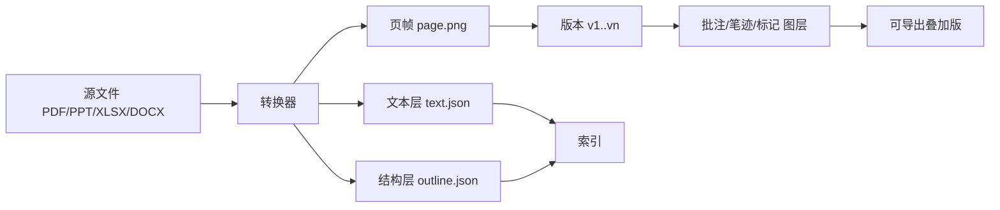

# 08 文档协作与文件互通

## 8.1 统一文档模型

所有格式最终都收敛到同一个模型，这是「多端一致」与「可检索」的前提。



| 层 | 内容 | 用途 |
| --- | --- | --- |
| 源文件 | 原始二进制 | 下载、归档、法务取证 |
| 页帧 | 定宽渲染图（默认 1600 px 宽） | 六端一致显示 |
| 文本层 | 每页文字与坐标框 | 检索、选中、复制、AI 摘要 |
| 结构层 | 标题、段落、表格、幻灯片大纲 | 大纲导航、语义检索 |
| 图层 | 批注、笔迹、高亮、标记 | 协作，不污染原件 |

关键取舍：**批注永不写回源文件**。写回会导致格式错乱、版本冲突、原件损坏。需要「带批注的版本」时，由服务端把图层合成到页帧上导出新 PDF，原件保持不变。

## 8.2 档案共享

档案库不是网盘，它有三条硬规则：

1. **一切入库对象都有责任人**（上传者 + 所属组织域）。
2. **一切对象都有保留策略**（到期自动归档或销毁，不可无限堆积）。
3. **一切对象都可追溯来源**（哪个会议、哪个议题、哪次上传）。

| 库类型 | 谁能读 | 保留 | 典型内容 |
| --- | --- | --- | --- |
| 会议档案 | 参会人 + 授权人 | 会议结束后 30 天转只读，按单位策略归档 | 材料、纪要、表决结果、录制 |
| 部门档案 | 本部门 | 1–3 年 | 部门制度、周报、项目资料 |
| 企业档案 | 全员或按密级 | 长期 | 制度、董事会材料、合同 |
| 小组档案 | 小组成员 | 6 个月–1 年 | 项目过程资料 |
| 外部共享区 | 被授权的外部方 | ≤ 90 天 | 对外提供的材料 |

## 8.3 PDF / PPT / Excel 的共享与协商

不同格式的协作能力差别很大，必须给出能力矩阵，避免承诺做不到的事。

| 能力 | PDF | PPT | Excel | Word |
| --- | --- | --- | --- | --- |
| 页帧浏览 | 是 | 是 | 是 | 是 |
| 批注/高亮/笔迹 | 是 | 是 | 是 | 是 |
| 文本在线编辑 | 否（只读） | 受限（文本框） | 是（单元格） | 是（段落） |
| 结构编辑（增删页/幻灯片） | 否 | 是（仅平台内新建） | 是（行列） | 否 |
| 公式计算 | 否 | 否 | 是（服务端重算） | 否 |
| 导出叠加版 | 是 | 是 | 是 | 是 |
| 原件下载 | 按权限 | 按权限 | 按权限 | 按权限 |

「共享协商」在平台里指三件事：

| 机制 | 说明 |
| --- | --- |
| 版本协商 | 多人基于同一版本批注；有人上传新版本时，旧批注按页锚点迁移，锚点失效的批注标记为「待确认」而非丢弃 |
| 检出/检入 | 需要大改时由一人检出，他人只能批注；检出超时 4 小时自动释放 |
| 冲突提示 | 同一页同一区域被两人标注为不同结论时，提示主持人裁决，系统不自动覆盖 |

版本迁移是最容易出错的地方：PPT 加了一页，后面所有页的批注都要顺移。做法是记录每页的「内容指纹」，新版本按指纹匹配而非页码匹配，指纹匹配失败才按页码近似，并明确告知用户。

## 8.4 协作与标记同步

协作分两条技术路线，按对象类型选择：

| 对象 | 技术 | 原因 |
| --- | --- | --- |
| 页帧批注、笔迹、标记 | 事件 + 服务端定序 | 操作离散、可幂等，不需要字符级合并 |
| 文本段落（Word 类） | CRDT（Yjs 类） | 并发插入删除必须无损合并 |
| 表格单元格（Excel 类） | 单元格级锁 + 操作日志 | 公式依赖要求确定性顺序 |
| 白板 | CRDT（地图型） | 无限画布、任意位置对象 |

批注事件结构：

```json
{
  "type": "anno.created",
  "rev": 418,
  "payload": {
    "docId": "d-91",
    "version": 3,
    "page": 12,
    "anchor": { "type": "rect", "x": 0.32, "y": 0.18, "w": 0.28, "h": 0.06, "fp": "sha256:9f2c..." },
    "kind": "highlight",
    "color": "#F5C542",
    "text": "这一条预算依据不足",
    "author": "u-2210"
  }
}
```

`anchor.fp` 是该区域的内容指纹，用于跨版本迁移。没有指纹的批注在换版后必然错位，这是实践中的头号问题。

Excel 协作要特别处理公式：平台只允许改值与样式，公式由服务端统一重算并把结果广播，避免各端用不同引擎算出不同结果。

## 8.5 分部门、分企业协同

| 场景 | 机制 |
| --- | --- |
| 部门内共享 | 组织域内默认可读，按密级收紧 |
| 跨部门借阅 | 申请 → 审批 → 限时授权（默认 7 天）→ 到期自动收回 |
| 跨企业协作 | 建立「协作空间」，双方各派管理员，成员白名单双向确认 |
| 集团—子公司 | 集团可读子公司汇总数据，子公司不可读兄弟公司明细 |
| 项目组（跨部门临时） | 临时组织域，项目结束自动解散，数据按策略归档或销毁 |

跨企业协作空间的三条铁律：成员必须双方确认；数据不落对端库（只做受控访问或加密副本）；解散时双方各留一份审计摘要。

## 8.6 NAS 互通（企业 / 部门 / 小组）

客户已有 NAS 是常态，平台不替换它，而是把它挂成「虚拟文件树」的一个节点。

| 层 | 设计 |
| --- | --- |
| 连接器 | SMB/CIFS、NFS、WebDAV、S3 兼容、FTP（仅内网） |
| 挂载粒度 | 企业级共享、部门级共享、小组级共享，各自独立凭据 |
| 权限映射 | NAS 的 ACL 映射到平台组织域；无法映射时降级为「只读 + 平台侧授权」 |
| 元数据 | 平台只索引元数据与文本，原件仍在 NAS |
| 缓存 | 热门文件按 LRU 缓存到对象存储，命中率目标 70% |
| 变更感知 | 定时扫描 + 文件系统事件（SMB notify）；冲突以 NAS 为准 |

必须接受的限制：NAS 侧权限变更平台无法实时感知，只能靠定时同步（默认 15 分钟）。因此对高密级文件，平台要求「双授权」：NAS 有权限 **且** 平台有授权，二者缺一不可。这条规则能挡住绝大多数越权访问。

## 8.7 跨组织共享的到期回收

委托授权是一个四元组：`(授权方, 被授权方, 对象集, 有效期)`。到期后系统做三件事：撤销访问、清理被授权方缓存、在对端残留副本标记失效。第三件最难，因为对端已经下载的文件无法收回，所以外部共享默认禁止下载，只允许在线查看 + 水印。

## 8.8 容量与性能

| 指标 | 目标 |
| --- | --- |
| 单文件上限 | 500 MB（超出走归档通道） |
| 单会议材料 | 300 页 / 50 个文件 |
| 转帧速度 | 100 页/分钟/实例 |
| 批注同步延迟 | P95 ≤ 300 ms |
| 虚拟文件树首屏 | ≤ 800 ms（1 万个节点） |
| 索引延迟 | 上传到可检索 ≤ 2 分钟 |

以上是「在线」侧的指标。会议现场要按时开始，还需要一条独立的准备链路：材料在会前就落到边缘网关与终端本地，这部分见第 19 章《离线预下载与会议准备》。两者的分界线是：第 8 章负责「对象怎么共享与协作」，第 19 章负责「对象怎么在会前抵达现场」。

---

下一章：`09_检索、溯源与审计.md`
