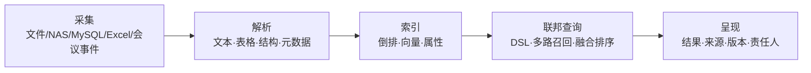

# 09 检索、溯源与审计

## 9.1 检索的四段链路



这条链路的价值不在「能搜到」，而在「搜到的每一条都能说清从哪来、谁改过、凭什么给你看」。最后一条决定它是搜索引擎还是泄密工具。

## 9.2 统一查询 DSL

对外只暴露一种查询语法，内部翻译成各库的原生查询。这样前端不必知道数据在 PG、MySQL 还是对象存储里。

```json
{
  "q": "预算 调整",
  "scope": ["dept:finance", "nas:group-a", "mysql:erp"],
  "filters": {
    "type": ["pdf", "xlsx", "sheet"],
    "updatedAt": { "gte": "2026-01-01" },
    "level": { "lte": 2 }
  },
  "sort": [{ "field": "relevance", "order": "desc" }],
  "page": { "size": 20, "from": 0 }
}
```

多路召回：关键词（BM25）+ 向量（语义）+ 属性（精确过滤）+ 结构（表格字段）。四路结果用 RRF（倒数排名融合）合并，避免单一路径的偏置。

排序不以「相关度」为唯一依据，而是四因子加权：相关度 0.5、时效 0.2、权威度 0.2（是否为正式版本）、使用频度 0.1。会议场景里，一份三个月前的正式版本往往比昨天的一稿草稿更有用。

## 9.3 Excel 建索引

Excel 是最容易被忽略、也最有价值的数据源。会议材料里大量的预算表、名单、进度表都是 Excel。

| 步骤 | 做法 | 难点 |
| --- | --- | --- |
| 结构识别 | 识别工作表、合并单元格、多表头行 | 表头可能跨两行、带合并 |
| 表头语义 | 按列名推断类型（金额/日期/人名/部门） | 列名口语化，如「金额（万元）」 |
| 单元格索引 | 每个非空单元格一条文档，带行列坐标 | 大表产生海量文档，需按行聚合 |
| 公式处理 | 索引计算结果值，同时保留公式文本 | 需服务端重算，不能信任缓存值 |
| 跨表关联 | 同名表头 + 同值实体做弱关联 | 仅提示，不做强结论 |

索引策略：小表（≤ 500 行）按行建文档，一行一条；大表按「行块」建文档（每 50 行一块）并保留列级字段，避免索引爆炸。

检索时用户搜「2026 年市场部差旅预算」，命中后返回的是「文件 + 工作表 + 行号 + 单元格」，点开直接定位到那一行并高亮。这比给一个文件链接有用得多。

## 9.4 MySQL 接入

客户既有业务系统多在 MySQL。平台不迁移它的数据，只做「受控联邦」：

| 项 | 要求 |
| --- | --- |
| 账号 | 只读、独立账号、最小权限（仅指定库表的 SELECT） |
| 连接 | 走只读从库，禁止连主库 |
| 增量 | 优先 CDC（binlog），不可用时定时全量比对 |
| 映射 | 表 → 虚拟视图，字段 → 平台属性，需人工确认映射 |
| 权限 | 平台侧再校验一次，不依赖源库权限 |
| 写入 | **默认不允许**。确需写入时走桥接服务，逐条审计 |

一个反面案例值得记住：某项目直接给平台一个读写账号，结果平台的批量同步任务把业务库的历史数据覆盖了。因此「只读」不是建议，是硬约束。

## 9.5 多库合一

「多个库合成一个，不同人员的数据交到一起」这件事，本质是**实体对齐**，不是拼接。

| 步骤 | 做法 |
| --- | --- |
| 实体定义 | 统一实体：人员、部门、文件、会议、项目、金额单据 |
| 对齐键 | 人员用工号/手机号/邮箱，部门用组织编码，文件用内容指纹 |
| 冲突 | 同一实体多源不一致时，按「源权威度」排序，保留差异并标注 |
| 视图 | 联邦视图只存映射关系，不复制数据 |
| 权限 | 查询时按请求者身份裁剪，不同人看到的「同一个视图」内容不同 |

举例：HR 系统的「张三」、OA 的「张三（研发）」、会议系统的「u-2210」，对齐后是一个人。搜索「张三参与的会议与报销单」时，三库结果合并呈现，但张三只能看到自己有权限的部分，财务只能看到金额相关部分。这就是「数据交到一起但不越权」的实现方式。

## 9.6 协作与写作集群

当同一份文档被多人同时编辑，单写者架构撑不住。平台按对象分片：

| 对象 | 分片键 | 一致性 |
| --- | --- | --- |
| 会议房间 | roomId 哈希 | 单写者（房间内串行） |
| 文档编辑 | docId 哈希 | CRDT / 单元格锁 |
| 索引写入 | 文档 ID 哈希 | 最终一致 |
| 审计链 | 租户 + 时间窗 | 追加写，链内串行 |

写作集群的关键是「锁的粒度」：整篇加锁会让协作退化成轮流编辑；按段落/单元格加锁才能真并发。平台默认按段落（Word）与单元格（Excel）加锁，锁持有超过 30 秒无操作自动释放。

## 9.7 溯源

溯源不是「查日志」，而是回答四个问题：这份东西从哪来、经过谁的手、改了什么、依据什么授权。

| 要素 | 存储 | 用途 |
| --- | --- | --- |
| 内容指纹 | 每次版本存 SHA-256 | 证明「这份文件就是当时那份」 |
| 事件链 | 追加写的事件表 | 还原操作序列 |
| 变更差异 | 版本间 diff（文本/结构） | 回答「改了什么」 |
| 授权快照 | 每次访问记录当时的权限判定结果 | 回答「凭什么给他看」 |
| 责任人 | 操作者 + 审批者 | 回答「谁负责」 |

追踪链结构：每个对象的每个事件记录 `prevHash`，形成哈希链；链头定期锚定到外部时间戳。任何人拿到对象与链，都能独立验证「未被篡改」。

## 9.8 审计与时间戳

### 9.8.1 三层审计

| 层 | 内容 | 保留 |
| --- | --- | --- |
| 业务审计 | 建会、改材料、授权、导出、销毁 | 180 天以上 |
| 安全审计 | 登录、越权尝试、密钥使用、插件装载 | 1 年 |
| 系统审计 | 配置变更、发布、备份、故障 | 1 年 |

### 9.8.2 时间戳

时间可信是审计成立的前提。平台三层校时 + 一层外部锚定：

| 层 | 机制 | 精度 |
| --- | --- | --- |
| 集群内 | NTP 到本地时间源 | ≤ 10 ms |
| 站点 | NTP 到国家授时中心（ntp.ntsc.ac.cn） | ≤ 50 ms |
| 记录 | 每条审计带服务端时间 + 序列号 | — |
| 外部锚定 | RFC 3161 时间戳（TSA），每小时对链头取一次 | 秒级 |

国家授时中心提供标准时间服务，可作为校时源；**但它不签发可用于司法的可信时间戳**。需要具备证据效力的时间戳时，必须对接具备资质的第三方时间戳服务（TSA）。这一点在方案里必须写清楚，否则客户验收时会发现「时间戳没有法律效力」。

### 9.8.3 对外审计服务器

平台支持把审计摘要推送给客户的审计系统或上级监管平台：

| 项 | 设计 |
| --- | --- |
| 通道 | 出站 HTTPS，mTLS，白名单域名 |
| 内容 | 事件摘要 + 链头哈希 + 批量签名，不含材料正文 |
| 频率 | 5 分钟批量 / 实时（可选） |
| 回执 | 对端返回签名回执，平台保存回执作为「已送达」证据 |
| 失败 | 本地队列积压，指数退避，超过 24 小时告警 |
| 离线 | 打包为可离线交接的审计包（含验签工具） |

审计包格式固定：`manifest.json`（含时间范围、条数、链头）、`events.ndjson`、`signature.sig`、`verify.md`（离线验签步骤）。这样即使平台下线，审计仍可被独立验证。

## 9.9 性能与容量

| 指标 | 目标 | 备注 |
| --- | --- | --- |
| 索引规模 | 单租户 1000 万文档 | 分片后可线性扩展 |
| 检索 P95 | ≤ 500 ms | 10 万文档、四路召回 |
| 索引延迟 | ≤ 2 分钟 | 上传到可搜 |
| 溯源查询 | ≤ 1 s | 单对象全链 |
| 审计写入 | 5000 条/秒 | 批量落盘 |

## 9.10 三条实施提醒

1. **先定实体，再谈联邦**。实体没对齐，多库合一只会产出重复结果。
2. **先定权限，再谈检索**。检索层不负责鉴权，鉴权必须在内核完成，检索只做「已授权集合内的排序」。
3. **先定时间源，再谈审计**。时间不可信，整条链都不可信。

---

下一章：`10_视频会议、录播与 AI 总结.md`
