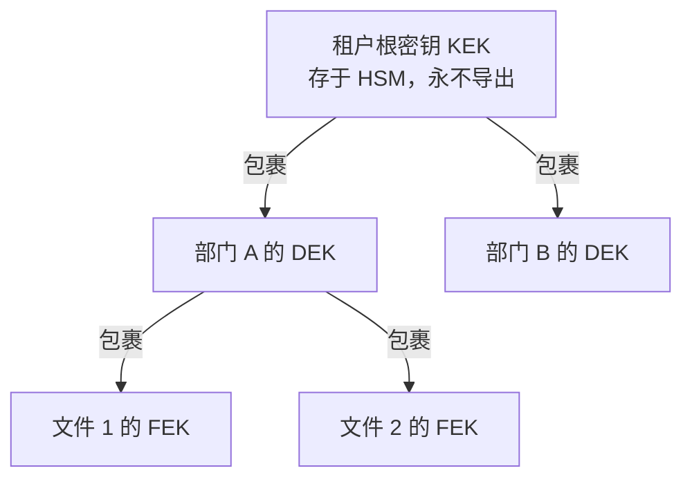

# 11 安全、加密与危险感知

## 11.1 威胁模型

先列清楚「谁想干什么」，否则安全措施会变成堆砌清单。

| 威胁 | 具体表现 | 对应控制 |
| --- | --- | --- |
| 内部越权 | 低密级用户看高密级材料 | 密级判定 + 对象级授权 |
| 内部外带 | 拍照、截屏、另存、转发 | 水印 + 防截屏 + 下载管控 |
| 账号盗用 | 密码撞库、会话劫持 | 双因子 + 设备指纹 + 短令牌 |
| 横向移动 | 攻破一台机器后访问数据库 | mTLS + 网络分区 + 最小权限 |
| 供应链 | 恶意依赖、插件后门 | 依赖审计 + 插件签名 + 沙箱 |
| 勒索/破坏 | 删除材料、加密数据 | 不可变备份 + 审计链 + 权限分离 |
| 抵赖 | 否认签过字、否认发过言 | 数字签名 + 时间戳 + 哈希链 |

## 11.2 三级安全域

企业、部门、小组不是三个标签，而是三层**策略继承**。

| 层级 | 策略示例 | 继承规则 |
| --- | --- | --- |
| 企业级 | 全员禁用外网下载；强制双因子；水印必开 | 最宽松下限，子级只能更严 |
| 部门级 | 财务部禁止移动端访问；研发部禁止截屏 | 可加严，不可放宽企业级 |
| 小组级 | 项目组材料仅组内可见，7 天自动销毁 | 可加严，不可放宽部门级 |

实现上，策略求值按「小组 → 部门 → 企业」自下而上收集，取交集（最严）。这条规则必须由内核统一执行，不允许插件自行判断，否则必然出现「某个插件绕过了策略」。

## 11.3 部门文件单独加密

需求是「部门文件单独加密」，工程上不能真给每个部门一把对称密钥直接加密文件——那样密钥数量会爆炸，且无法支持跨部门授权的临时共享。正确做法是**信封加密三层结构**：

| 层 | 作用 | 生命周期 |
| --- | --- | --- |
| KEK | 租户根密钥，仅在 HSM 内使用 | 5 年，轮换需重包裹全部 DEK |
| DEK | 每个部门/小组一把，隔离部门数据 | 1 年 |
| FEK | 每个文件一把，一次性 | 随文件销毁 |

加密流程：生成随机 FEK → 用 DEK 包裹 FEK → 用 FEK 加密文件内容（分块 GCM）→ 存 `{encDEK, encFEK, iv, tag}`。解密时反向：HSM 解 KEK → 解 DEK → 解 FEK → 解内容。全程 FEK 与 DEK 明文只在内存中短暂存在，用完清零。

这样做的好处有三个：部门之间天然隔离（A 部门拿不到 B 的 DEK）；跨部门共享只需「把 FEK 再用对方 DEK 包一份」，不复制文件；单个文件泄露只影响该文件。

## 11.4 密钥存储

| 项 | 设计 |
| --- | --- |
| 主密钥 | HSM / 密码机，私钥不出设备，业务侧只持句柄 |
| 应用密钥 | KMS 服务，内存缓存有效期 5 分钟，禁用落盘 |
| 配置密钥 | 启动时从 KMS 拉取，注入进程内存，不写配置文件 |
| 备份 | 密钥备份分片（3 份，2 份可恢复），异地存放，双人管 |
| 轮换 | DEK 1 年、KEK 5 年、TLS 证书 1 年、令牌签名密钥 90 天 |
| 销毁 | 双人操作 + 审批 + 审计留痕，销毁后数据不可恢复（这是特性不是缺陷） |
| 审计 | 每次密钥使用记录「谁、何时、用于哪个对象」，不记录密钥值 |

一条必须坚守的规则：**密钥永不出域**。跨组织协作时，不交换密钥，而是交换「加密后的内容 + 对方的公钥包裹」，或者干脆只给在线访问权。

## 11.5 数据外泄防护

| 通道 | 控制 |
| --- | --- |
| 截屏 | PC/移动端启用系统级禁止截屏；网页端无法禁止，改为水印 + 行为审计 |
| 复制 | 禁用系统剪贴板跨应用复制，或只允许复制带水印的纯文本 |
| 另存/打印 | 禁用打印接口；导出需审批，导出件带盲水印 |
| 转发 | 文件链接绑定设备与身份，转发即失效 |
| 拍照 | 无法技术阻止，靠水印追责 + 会议须知告知 |

必须诚实说明：**网页端与任何开放浏览器都无法彻底阻止截屏**。谁承诺可以，就是在骗客户。平台采取的是「提高成本 + 事后可追溯」，并在方案中明确写为「管理措施 + 技术措施」组合。

## 11.6 病毒扫描与文件沙箱

| 阶段 | 动作 | 失败处理 |
| --- | --- | --- |
| 上传前 | 客户端校验类型与大小 | 拒绝 |
| 上传中 | 流式落盘到隔离区 | — |
| 落盘后 | ClamAV 或商业引擎扫描 | 命中即隔离，通知上传者 |
| 解析前 | 沙箱解析（LibreOffice 无头，无网络、限时、限内存） | 超时或崩溃标记「解析失败」 |
| 转帧后 | 二次扫描产物 | 同上 |
| 定期 | 存量全量复扫（每周） | 命中则冻结并告警 |

沙箱必须做到三隔离：网络隔离（无出网）、资源隔离（CPU/内存/时间上限）、文件隔离（只读挂载输入，输出重定向）。解析 Office 文件的漏洞利用是最常见的攻击面，这一步不能省。

## 11.7 危险感知

危险感知不是「装个 IDS」，而是对**行为序列**建模。

| 信号 | 特征 | 权重 |
| --- | --- | --- |
| 异常时段访问 | 凌晨 2–5 点访问高密级材料 | 中 |
| 批量下载 | 5 分钟内下载 > 20 份 | 高 |
| 越权尝试 | 连续访问无权对象 > 3 次 | 高 |
| 异地登录 | 30 分钟内两地登录 | 高 |
| 设备异常 | 新设备 + 新地点 + 高密级 | 高 |
| 插件异常 | 插件出网请求突增 | 中 |
| 数据外发 | 审计推送失败率突增 | 中 |

评分模型：`risk = Σ(权重 × 频次因子 × 敏感度因子)`，阈值分三档：

| 分档 | 动作 |
| --- | --- |
| 低（< 30） | 记录 |
| 中（30–70） | 二次认证、限速、通知安全员 |
| 高（> 70） | 自动熔断：冻结会话、撤销令牌、隔离该账号的下载能力 |

自动熔断必须可回滚：安全员可一键恢复，但恢复动作本身入链。误杀比漏杀更常见，因此默认只冻结「高风险动作」而非整个账号。

## 11.8 等保与国密

| 要求 | 实现 |
| --- | --- |
| 身份鉴别（三级） | 双因子 + 设备指纹 |
| 访问控制 | RBAC + ABAC + 能力令牌，默认拒绝 |
| 安全审计 | 三层审计 + 哈希链 + 外部时间戳，留存 ≥ 180 天 |
| 入侵防范 | 最小镜像、漏洞扫描、上传扫描 |
| 数据完整性 | TLS 1.3 / SM2-SM3-SM4 套件 |
| 数据保密性 | 信封加密 + HSM |
| 剩余信息保护 | 会话销毁、缓存清理、内存清零 |
| 个人信息 | 最小采集 + 明示 + 可撤回 |

国密改造要点：TLS 用 SM2 双证书套件；签名用 SM2；摘要用 SM3；对称加密用 SM4-GCM。改造必须在密码机支持的前提下进行，纯软件实现无法通过密评。

## 11.9 应急响应

| 级别 | 判定 | 响应时限 | 动作 |
| --- | --- | --- | --- |
| P1 | 数据外泄、系统被控 | 30 分钟 | 隔离、取证、上报、通知客户 |
| P2 | 大范围越权、密钥异常 | 2 小时 | 吊销令牌、轮换密钥、排查 |
| P3 | 单点异常、扫描告警 | 1 个工作日 | 分析、修补 |
| P4 | 一般告警 | 3 个工作日 | 工单处理 |

取证要求：保留内存镜像、日志、审计链、涉事账号全量行为，取证过程本身也要留痕。

---

下一章：`12_高可用、熔断与运维.md`
