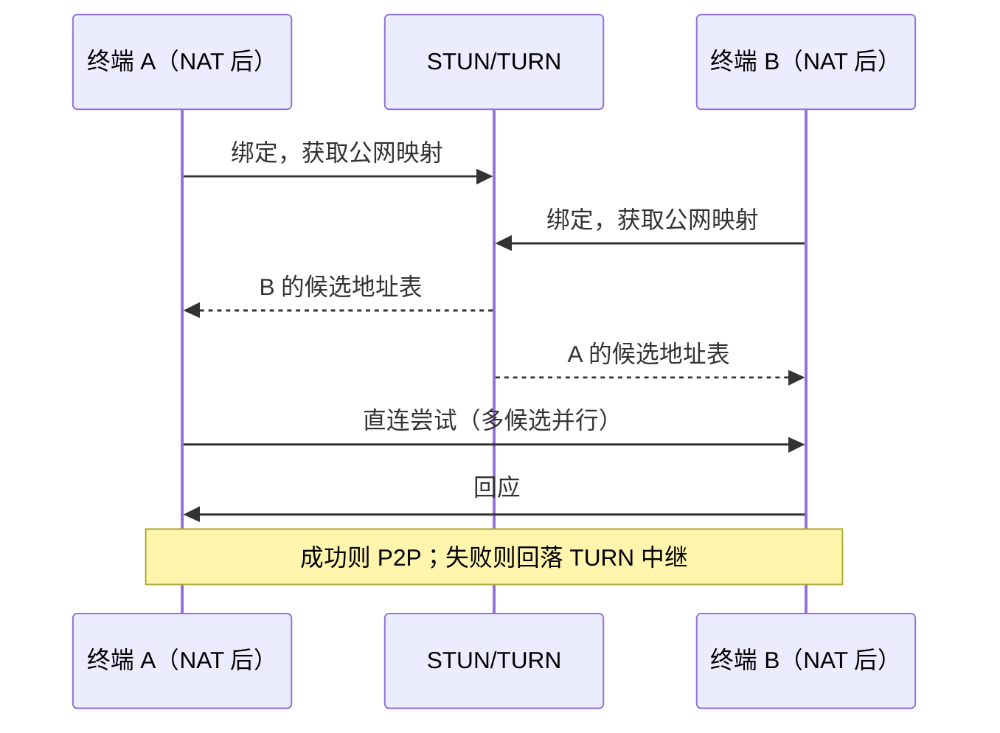

# 13 网络互通与去中心化

## 13.1 五种网络现场

现场永远是这五种的组合，方案必须逐条覆盖，不能只在「理想公网」上设计。

| 场景 | 特征 | 可用方案 | 不可用方案 |
| --- | --- | --- | --- |
| 同网段 | 同一 VLAN | 直连 | — |
| 跨网段 | 有路由但策略严格 | 网关中继、端口白名单 | P2P 打洞 |
| NAT 后 | 家庭宽带、分支出口 | 打洞 + 中继兜底 | 直连 |
| 隔离网 | 物理隔离、单向导入 | 离线包、单向光闸 | 任何实时通道 |
| 公网访问 | 出差、外协 | 反向隧道 / 零信任网关 | 端口映射 |

## 13.2 DDNS

分支机构的公网 IP 会变，DDNS 负责让中心找到它。

| 项 | 设计 |
| --- | --- |
| 客户端位置 | 边缘网关内置，不依赖路由器 |
| 协议 | 标准 DDNS 更新（RFC 2136 或服务商 HTTP API） |
| 服务商 | 自建 DDNS 服务、阿里云/腾讯云解析、单位自建 DNS |
| 记录 | A / AAAA 记录，TTL 60 秒 |
| 安全 | 更新凭据按设备签发、可撤销；更新走 HTTPS + 签名 |
| 失败处理 | 本地缓存上次成功 IP，更新失败告警但继续工作 |

注意：DDNS 只解决「找到地址」，不解决「安全访问」。暴露在公网的入口必须配零信任网关，不能直接暴露应用端口。

## 13.3 打洞

| NAT 组合 | 打洞成功率 | 备注 |
| --- | --- | --- |
| 全锥 + 全锥 | ≈ 100% | 最理想 |
| 全锥 + 受限 | ≈ 95% | 常见 |
| 受限 + 受限 | ≈ 70–85% | 取决于端口分配策略 |
| 对称 + 任意 | < 30% | 基本靠中继 |

工程结论：**不要指望打洞一定成功**，必须内建 TURN 中继。中继成本可算：1080p30 单路约 2 Mbps，一路中继一小时约 0.9 GB，按并发峰值预留带宽。

自建 TURN 与云 TURN 的选择：数据不出域要求自建；弹性要求云。混合方案是「自建为主 + 云为峰值溢出」。

## 13.4 内网穿透

内网服务要被外部访问，只有两条正道：反向隧道与零信任网关。端口映射是第三条，也是最危险的一条，方案中明确排除。

| 要素 | 设计 |
| --- | --- |
| 隧道 | 内网侧主动外连（出站 443），建立长连接；外部请求经隧道进入 |
| 认证 | 双向 mTLS，证书按设备签发 |
| 授权 | 每条隧道声明「允许访问的路径」，非声明路径一律 404 |
| 票据 | 外部访问需一次性票据（60 秒有效，绑定 IP 与 UA） |
| 审计 | 每次穿透访问记录来源、路径、结果 |
| 限流 | 按隧道与按来源双限 |
| 熔断 | 异常流量触发隧道断开，需人工恢复 |

必须禁止的三件事：全端口映射、明文（非 TLS）隧道、隧道账号与业务账号共用。这三件事在渗透测试中几乎必然被判定为高危。

## 13.5 去中心化协作

「去中心化合作」在政企场景的真实含义通常不是区块链，而是**多个单位各自部署、互相协作、没有一个单位能单方面看全对方数据**。平台用「联盟节点」实现：

| 要素 | 设计 |
| --- | --- |
| 节点 | 每个单位一个独立部署，自治 |
| 身份 | 各节点自建 CA，互相交换根证书，形成信任环 |
| 共享 | 内容寻址（哈希）+ 加密副本，不共享数据库 |
| 授权 | 双方管理员双签的授权凭据，带对象范围与期限 |
| 同步 | 事件级同步（只同步授权的对象变更），冲突以源节点为准 |
| 撤销 | 到期或主动撤销，对端删除副本并回执 |
| 审计 | 各节点各留一份审计摘要，可交叉验证 |

为什么不用中心化：中心化意味着必须有一个单位托管所有单位的数据，这在跨企业、跨层级协作中通常不可接受。去中心化不是技术偏好，是治理要求。

代价要说清楚：跨节点的一致性只能是最终一致，且「撤销后对端是否真的删了」只能靠回执与信用，技术无法强制。

## 13.6 安全底线

| 底线 | 原因 |
| --- | --- |
| 任何入口不暴露应用端口 | 减少攻击面 |
| 隧道必须 mTLS | 防中间人 |
| 穿透路径白名单 | 防横向遍历 |
| 一次性票据 | 防链接泄露 |
| 出站也要管控 | 防数据外带 |
| 隔离网不用实时通道 | 物理隔离不可绕过 |

## 13.7 运维要点

| 项 | 要求 |
| --- | --- |
| 隧道健康 | 每 30 秒心跳，连续 3 次失败告警 |
| 证书 | 提前 60 天续期告警 |
| 带宽 | 按隧道统计进出流量，异常增长告警 |
| 日志 | 保留 90 天，含来源 IP 与路径 |
| 演练 | 每半年做一次「隧道断开 + 中继切换」演练 |

---

下一章：`14_行业赋能与 DIY 交付.md`
