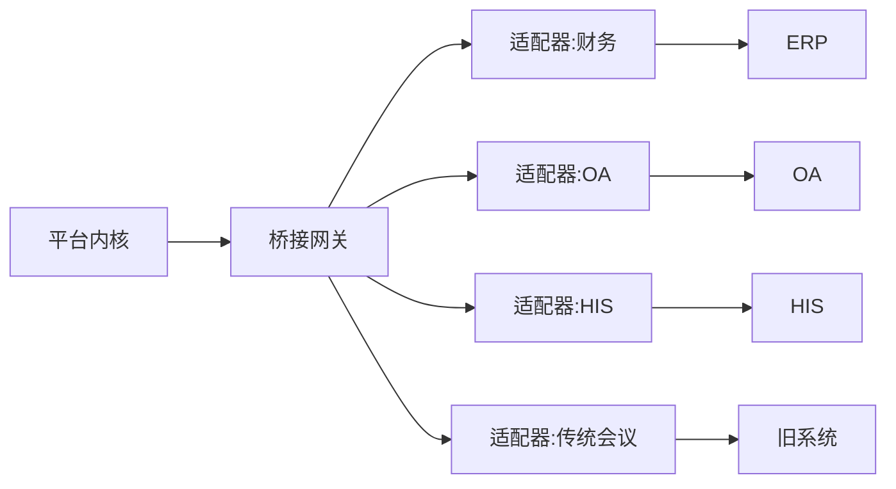

# 15 对外集成与 GitHub 资产整合

## 15.1 三条对外通道

对外集成只有三条路，选错路会在半年后变成维护灾难。

| 通道 | 形态 | 适用 | 风险 |
| --- | --- | --- | --- |
| API 桥接 | 平台暴露/消费 REST/事件 | 双向业务集成（财务、OA、HIS） | 对方接口变更 |
| 数据导出 | 批量导出（文件/包） | 归档、监管报送、离线分析 | 时效差 |
| 事件订阅 | Webhook / 消息队列 | 准实时通知（会议结束、决议生成） | 重复投递、乱序 |

原则：**实时用事件，批量用导出，双向用桥接**。三者不要混用，尤其不要用「轮询接口」冒充实时。

## 15.2 API 桥接网关

桥接网关是平台与外部世界的唯一出口，所有出站流量必须经过它。

| 功能 | 要求 |
| --- | --- |
| 协议转换 | REST / SOAP / 数据库 / 文件 / MQ，统一转为内部事件 |
| 鉴权 | 出站用 mTLS 或签名，凭据由 KMS 托管，不落配置文件 |
| 白名单 | 目标域名/IP 白名单，未声明一律拒绝 |
| 限流 | 按目标系统 QPS 限流，防把对方打挂 |
| 幂等 | 每条出站请求带 `idempotencyKey`，对方支持则复用，不支持则本地去重 |
| 重试 | 指数退避，最多 5 次，超过入死信队列人工处理 |
| 审计 | 请求/响应摘要入链（不含敏感正文） |
| 可观测 | 每条链路有 traceId，可查「为什么这条没发出去」 |

## 15.3 财务系统对接

财务是最容易做砸的集成，因为它要求「金额不能错、单据不能重、时点不能乱」。

| 场景 | 数据流 | 关键控制 |
| --- | --- | --- |
| 会议费用归集 | 会议 → 费用单据 → 财务凭证 | 金额与科目映射表 |
| 差旅报销 | 报销单 → 审批 → 凭证 | 幂等键 = 单据号 + 版本 |
| 预算占用 | 会议立项 → 预算冻结 → 实际核销 | 两阶段：冻结/确认 |
| 发票查验 | 发票 → 查验服务 → 结果回写 | 失败不阻断主流程 |
| 对账 | 每日差额比对 | 差异清单 + 人工确认 |

科目映射表由客户财务确认，平台不预设立场。映射变更需版本化，历史凭证按当时映射解释，不能因为改了映射就把旧账算错。

对账任务的输出必须可执行：不是「有 3 笔差异」，而是「这 3 笔的单号、金额、差异原因、建议动作」。

## 15.4 传统系统与第三方会议

见第 06 章。此处补充一条：对接第三方会议系统时，**不要把两套会控混在一起**。正确做法是「一方主控、一方跟随」，否则会出现两边都能翻页、互相打架。

## 15.5 GitHub 资产盘点

> 说明：2026-11-05 已联网核实（github.com/yxpil 公开仓库页共 60+ 仓库，并逐项核对 ONRouter README）。下表定位信息不变，「缺口」列已按核实结果修正；§15.5.1 已用真实仓库填成确定矩阵。Aisprithill（个人站点体系，未对应公开仓库）与心云喵（品牌 IP）属站外/私有资产，仍待你补充。

| 资产 | 已知定位 | 可复用到本系统 | 缺口 |
| --- | --- | --- | --- |
| ONRouter | 自研网关，已迭代至 v1.0.x（README 已核：MIT），替代 OpenResty | 直接作为**接入网关/桥接网关的 HTTP 层**：路由、限流、WAF、灰度、日志；上游 mTLS、熔断、Prometheus、E2E 回归均已实现 | 需补**入站** mTLS 客户端认证（上游 mTLS 已有）、能力令牌校验、房间级限流 |
| PilScript | 自研多语言寄生语言 | 作为**插件脚本运行时**：轻量规则、协议编解码、行业模板逻辑 | 需补沙箱（资源/网络隔离）、确定性执行、审计钩子 |
| Aisprithill | 个人站点/项目体系，含 yxpil.com | 作为**门户与开发者站点**：插件市场、文档站、SDK 下载 | 需补多租户登录、插件签名分发 |
| 心云喵 | 表情包 IP | 品牌与产品人格化资产（引导页、空状态、帮助） | 与工程无关，属品牌层 |
| learn_ 系列 | 教学/示例仓库 | 作为**示例与培训资产**：上手 demo、SDK 示例 | 需按本系统重构示例结构 |
| TTS/视频生成实践 | 已有 TTS 视频能力 | AI 纪要的**语音播报**、会议回顾短片 | 需接入正式流水线与版权合规 |
| WAF/漏洞实践经验 | Web 安全方向积累 | 危险感知规则库、网关防护策略 | 需产品化（规则可配置、可灰度） |

### 15.5.1 仓库清单（2026-11-05 已按 github.com/yxpil 公开仓库核实）

| 仓库 | 类型 | 语言 | 现状 | 打算怎么用 |
| --- | --- | --- | --- | --- |
| yxpil/ONRouter | 服务/网关 | Rust | **MIT**，v1.0.x，文档齐全（能力矩阵/E2E 回归/部署清单），单二进制跨平台 | **复用**：接入网关与 paperless-bridge 底座；业务校验（能力令牌、房间级限流）用其 Lua/WASM 插件层补 |
| yxpil/PILScript | 库/脚本语言 | Rust | **MIT**，约 1500 行树遍历解释器，dlopen 直调 C/C++/Rust/Zig/Go | **复用后改造**：轻量插件脚本运行时；FFI 直调无沙箱，接入前必须加资源/网络隔离与审计钩子 |
| yxpil/openmeet | 服务/会议 | TypeScript | **MIT**，Electron + WebRTC Mesh + Node 服务端，LAN IPv4/IPv6 直连、STUN/TURN | **复用试点**：§10 视频会议「自建 Mesh」路线现成底座，先小会场景验证再评估是否上 SFU |
| yxpil/EasyPush | 工具/投屏接收 | TypeScript | **MIT**，Windows 接收端：手机摄像头、媒体上传、屏幕共享、DLNA | **复用**：投屏三通道中 DLNA/浏览器通道接收端，天然覆盖手机与老设备 |
| yxpil/PILBroadcast | 工具/投屏发送 | Rust/TS | **MIT**，Tauri v2，xcap 截屏 + MJPEG 推流，画质/帧率/显示器可调 | **复用**：主持端/白板画面广播通道，与 EasyPush 组成同屏收发两端 |
| yxpil/PILPublisher | 工具/文件分发 | Rust/TS | **MIT**，v0.1.8，LAN 内嵌 HTTP 文件服务，扫码浏览/上传/管理，权限密码独立开关 | **复用参考**：会议材料分发与离线预下载（§19）的局域网通道 |
| yxpil/SM4Kit | 库/国密 | C 多语言 | **MIT**，SM4（GB/T 32907-2016）8 语言零依赖，统一 API + 标准测试向量 | **复用**：§11 信封加密的 SM4 算法层，六端统一实现 |
| yxpil/ULocker | 工具/加密容器 | Python | **MIT**，AES-256-GCM 分块加密 + Argon2id 派生，U 盘序列号绑定 | **参考**：加密会议包（§19）的容器与密钥派生交互（去掉 U 盘绑定） |
| yxpil/ROMbay | 服务/DB 代理 | JavaScript | 内存化 MySQL 协议代理，含认证、权限、SQL 执行审计 | **参考**：§09 MySQL 联邦接入的协议层实现 |
| yxpil/Nebula | 库/检索 | Rust | **MIT**，BM25 全文检索、类 SQL、Argon2id+ChaCha20 单文件加密存储 | **参考**：端侧加密缓存与本地检索；服务端检索仍按 §09 自建 |
| yxpil/sniffgate | 服务/HA 网关 | Rust | **MIT**，TCP/UDP 统一入口、后端健康嗅探、主备秒级热切换、配置热加载 | **复用**：§12 主备与边缘网关 HA 组件 |
| yxpil/CloudSH | 工具/穿透 | Rust | **Apache-2.0**，被控端主动外连云 VPS，穿透 NAT，无公网 IP 远程执行 | **复用**：§13 内网穿透与远程运维通道（外层套§05 远程控制四道锁收权） |
| yxpil/maylin | 服务/进程编排 | Rust | **MIT**，无 Docker 子进程插件化（node/python/binary）、RBAC+Token、负载均衡、WS 终端 | **候选**：三档部署（§03）的服务编排器，替代部分容器化诉求 |
| yxpil/ADONWORD | 服务/安全守护 | Rust | **Apache-2.0**，文件完整性基线、可疑进程监控、监听端口告警 | **复用**：§11 危险感知与自动熔断的探针层 |
| yxpil/PLocalSwitch | 服务/LLM 网关 | Rust | **Apache-2.0**，统一 OpenAI v1 契约，双向转换 13 类上游，双账本计费 | **复用**：§10 AI 纪要的 LLM 接入层与用量核算 |
| yxpil/HUMIX | 工具/TTS | TypeScript | **Apache-2.0**，旋律驱动人声合成 + OK_TTS 音素库 | **候选**：AI 纪要语音播报；与正式 TTS 流水线（§15.5 上表）对比后择一 |
| yxpil/multilingual-sensitive-words | 数据/词库 | 数据 | **Apache-2.0**，108 语言 × 4 类词库（源自 fwwdn/sensitive-stop-words） | **复用**：文档/消息内容审核过滤（§11 沙箱扫描的文本侧补充） |
| yxpil/DOCPI | 服务/文档门户 | Rust/TS | **Apache-2.0**，项目→文件夹→文档三级结构、权限登录、全文搜索、SQLite | **参考**：制度/纪要门户（§08 档案共享的轻量实现参考） |
| yxpil/drawbuddy、yxpil/ControlEcharts | 工具/图表 | HTML/JS | **Apache-2.0 / MIT**，Mermaid + Chart.js / ECharts 离线工作台 | **参考**：AI 纪要图表渲染（§10）与白板图形组件（§17） |
| yxpil/yxpil-ui | 设计系统 | CSS | 颜色令牌 → 6 套主题 → y-* 语义组件类，单文件 CSS + Tailwind v4 预设 | **参考**：§17 UI 设计标准的令牌组织方式 |
| yxpil/PILinstaller | 工具/安装器 | TS/C# | Windows 安装包生成器（WPF 向导 + 卸载项 + MCP 工具） | **复用**：Windows 端交付安装包生成（§02 构建签名链路末端） |
| yxpil/ToAPI | 工具/测试 | TypeScript | Electron + SQLite 的 API 请求测试工具 | **复用**：联调与接口回归辅助 |
| yxpil/learn_*（约 15 个：crdt_merge / circuit_breaker / backpressure / saga / cqrs / event_sourcing / strangler_fig 等） | 文档/示例 | Python | 教学示例，每个演示一个模式 | **培训资产**：其中 CRDT 合并、熔断、背压与 §12/§13 机制直接对应，可作内部培训教材 |
| yxpil/bit（已归档）→ BrainTentacle、BITSDK、TentacleTool、MemoryPool、PANOPTES、HOWCUEME、SECFORGE、Neton、Firelin | 工具/AI 生态 | Rust/TS | 多为 **Apache-2.0/MIT**；bit 已归档更名触手怪（BrainTentacle） | **内部提效**：研发辅助与 AI 纪要流水线工具链，不做产品运行时依赖 |
| yxpil/A-PILCat | 素材/表情包 | Python | **Apache-2.0**，250 张 + 228 条文案，PNG/WebP/GIF | **品牌资产**：产品人格化素材池（与心云喵同层，待确认是否同 IP） |

> 未核/站外资产：Aisprithill（个人站点体系，未对应公开仓库）、心云喵（品牌 IP）、以及任何私有仓库——仍需你补充。判断标准三条不变：能独立跑起来吗？有测试吗？许可证允许商用吗？三条都过才考虑复用，否则宁可重写——半成品代码的整合成本往往高于重写。

## 15.6 需要新增的资产

按优先级排，前五项是「没有它系统不成立」的：

| 优先级 | 资产 | 作用 | 预估规模 |
| --- | --- | --- | --- |
| P0 | `paperless-kernel` | 身份/权限/rev/审计钩子 | 6 人月 |
| P0 | `paperless-plugin-sdk` | 插件契约与沙箱 | 3 人月 |
| P0 | `paperless-render-core` | 六端共享渲染 | 8 人月 |
| P0 | `paperless-bridge` | 对外桥接网关（可基于 ONRouter 扩展） | 4 人月 |
| P0 | `paperless-search` | 联邦检索与索引 | 5 人月 |
| P1 | `paperless-kms` | 密钥服务与 HSM 适配 | 3 人月 |
| P1 | `paperless-audit-relay` | 审计链与时间戳外推 | 2 人月 |
| P1 | `paperless-media` | 录制与 ASR 编排 | 4 人月 |
| P1 | `paperless-edge` | 边缘网关（可基于 ONRouter + PilScript） | 4 人月 |
| P2 | `paperless-federation` | 联盟节点同步 | 6 人月 |

> 口径说明：本表为**资产粒度**的独立估算（含 18.4 未单列的 plugin-sdk / audit-relay / federation），与 18 章 18.4 的**模块粒度**估算存在粒度差，两表不可逐行相加或对比；立项预算以 18 章 87 人月为准，本表仅用于资产拆包、复用与外包决策。

## 15.7 对接系统设计：PaperlessHub

把上面的资产拼起来，需要一个「集成层」产品，暂称 PaperlessHub。它不是又一个系统，而是**一层胶水**，负责五件事：

| 模块 | 职责 | 依赖资产 |
| --- | --- | --- |
| 接入路由 | 统一入口、mTLS、令牌校验、限流 | ONRouter |
| 协议适配 | REST/SOAP/DB/文件 → 内部事件 | bridge + 适配器插件 |
| 脚本运行时 | 轻量业务规则、字段映射、编解码 | PilScript |
| 分发与签名 | 插件包签名、灰度、回滚 | Aisprithill 站点 + KMS |
| 观测与审计 | traceId 串联、出站审计、告警 | audit-relay + 监控 |

一句话总结：**ONRouter 做门，PilScript 做手，Aisprithill 做柜台，kernel 做大脑**。四者拼起来正好覆盖「接入—转换—分发—治理」，缺的那块是「协作内核与渲染」，必须新写。

## 15.8 集成验收

| 项 | 标准 |
| --- | --- |
| 接口连通 | 全部声明的出站目标可达，未声明的不可达 |
| 幂等 | 同一请求重放 3 次，对方只产生 1 条记录 |
| 失败恢复 | 断开对方系统 10 分钟后恢复，积压自动补发成功 |
| 审计完整 | 每条出站请求可在审计链中查到 |
| 性能 | 桥接层附加延迟 ≤ 50 ms（P95） |
| 安全 | 渗透测试无高危，凭据不出现在日志与配置 |

---

下一章：`16_服务端与前端详细设计.md`
