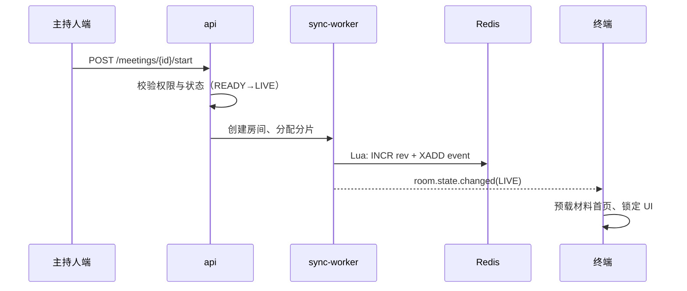
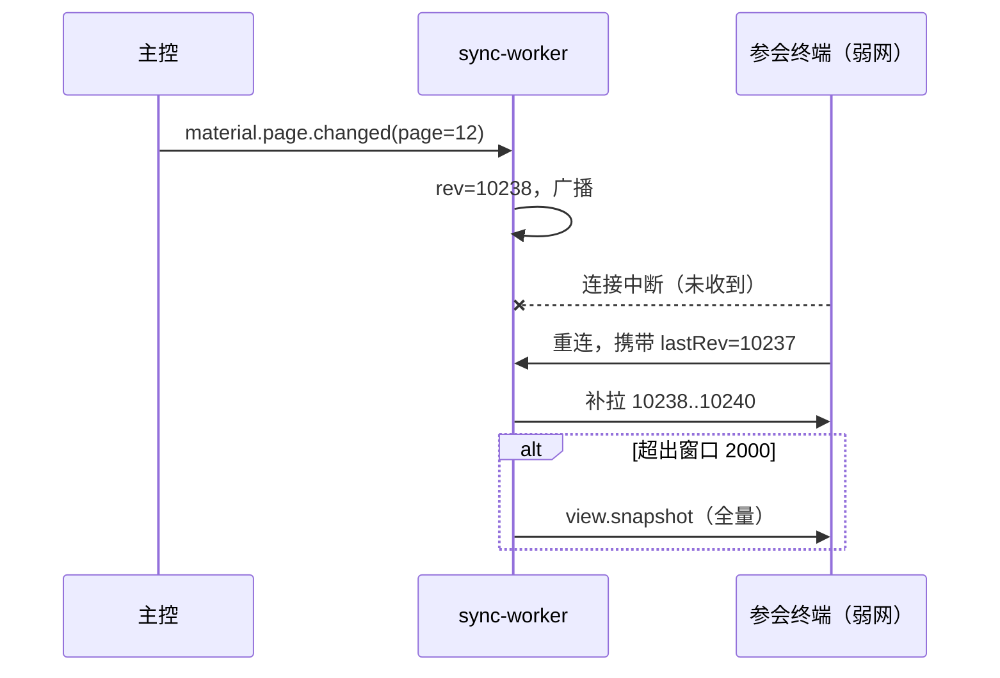

# 16 服务端与前端详细设计

## 16.1 服务端分层

```
controller（协议层） → application（用例编排） → domain（领域模型与规则） → infrastructure（存储与外部）
```

| 层 | 允许做什么 | 禁止做什么 |
| --- | --- | --- |
| controller | 参数校验、鉴权、组装响应 | 写业务判断、直接访问数据库 |
| application | 编排用例、事务边界、发事件 | 持有 HTTP 上下文 |
| domain | 状态机、规则、不变量 | 依赖框架、依赖 IO |
| infrastructure | 仓储实现、缓存、外部调用 | 反向调用 domain 之外的业务 |

依赖方向单向，CI 用 `dependency-cruiser` 强制。这条规则的价值在于：领域层可以脱离数据库与框架做单元测试，覆盖率才有意义。

## 16.2 模块清单

| 模块 | 聚合根 | 关键职责 | 依赖 |
| --- | --- | --- | --- |
| identity | User / Tenant / Org | 认证、令牌、组织域、权限求值 | 无 |
| meeting | Meeting | 状态机、议程、参与者、分组 | identity |
| material | Material / Version | 上传、转帧、版本、密级 | meeting, storage |
| sync | Room | rev 分配、事件广播、快照、补拉 | meeting |
| annotation | AnnoSet | 批注、笔迹、锚点迁移 | material |
| vote | Ballot | 表决、计票、匿名、离线补传 | meeting |
| minutes | Minutes | 纪要生成、签审、决议与待办 | meeting, ai |
| device | Device / Edge | 注册、影子、指令、固件版本 | 无 |
| collab | DocSession | CRDT 合并、单元格锁 | material |
| search | IndexDoc | 采集、索引、联邦查询 | 全部只读 |
| audit | Chain | 事件链、锚定、外推 | 无 |
| plugin | PluginInstance | 装载、权限、健康、卸载 | 全部受控 |

## 16.3 关键时序

### 16.3.1 开局



### 16.3.2 翻页与补拉



### 16.3.3 表决

| 步 | 动作 | 幂等保障 |
| 1 | 创建表决（选项、匿名、计时） | voteId 唯一 |
| 2 | 广播 `vote.opened` | rev |
| 3 | 终端提交 `vote.cast` | `opId` 去重 + 明细唯一索引 (voteId, userId) |
| 4 | 截止或全员完成 | 定时器 |
| 5 | 计票并广播结果 | 结果由明细重算，不信任缓存 |
| 6 | 结果入链 | 链上记录明细哈希 |

## 16.4 核心表（摘要）

```sql
CREATE TABLE meeting (
  id            text PRIMARY KEY,
  tenant_id     text NOT NULL,
  org_id        text NOT NULL,
  title         text NOT NULL,
  state         text NOT NULL,          -- DRAFT/READY/LIVE/PAUSED/CLOSED/ARCHIVED/CANCELED
  level         smallint NOT NULL,      -- 1..4 密级
  start_at      timestamptz,
  end_at        timestamptz,
  created_by    text NOT NULL,
  rev           bigint NOT NULL DEFAULT 0,
  created_at    timestamptz NOT NULL DEFAULT now()
);

CREATE TABLE room_event (
  room_id    text NOT NULL,
  rev        bigint NOT NULL,
  type       text NOT NULL,
  payload    jsonb NOT NULL,
  op_id      text,
  from_id    text,
  ts         timestamptz NOT NULL DEFAULT now(),
  prev_hash  text,
  hash       text NOT NULL,
  PRIMARY KEY (room_id, rev)
);

CREATE TABLE material_version (
  id          text PRIMARY KEY,
  material_id text NOT NULL,
  version     int NOT NULL,
  sha256      text NOT NULL,
  pages       int NOT NULL,
  object_key  text NOT NULL,
  created_by  text NOT NULL,
  created_at  timestamptz NOT NULL DEFAULT now(),
  UNIQUE (material_id, version)
);

CREATE TABLE annotation (
  id         text PRIMARY KEY,
  doc_id     text NOT NULL,
  version    int NOT NULL,
  page       int NOT NULL,
  anchor     jsonb NOT NULL,           -- {type,x,y,w,h,fp}
  kind       text NOT NULL,
  payload    jsonb NOT NULL,
  author_id  text NOT NULL,
  created_at timestamptz NOT NULL DEFAULT now()
);

CREATE TABLE audit_event (
  id         text PRIMARY KEY,
  tenant_id  text NOT NULL,
  actor_id   text,
  action     text NOT NULL,
  object_ref text,
  decision   jsonb,                    -- 权限快照
  prev_hash  text,
  hash       text NOT NULL,
  ts         timestamptz NOT NULL DEFAULT now(),
  anchored   boolean NOT NULL DEFAULT false
);
```

完整 DDL（含索引、分区、外键策略）随迁移脚本交付，共 19 张核心表，此处只列骨架。

## 16.5 REST 接口清单（节选）

| 方法 | 路径 | 说明 |
| --- | --- | --- |
| POST | `/v1/auth/login` | 密码登录，返回会话 |
| POST | `/v1/auth/mfa/verify` | 双因子校验 |
| GET | `/v1/tenants/discover` | 按域名/邀请码定位租户 |
| POST | `/v1/meetings` | 建会 |
| POST | `/v1/meetings/{id}/start` | 开局（READY→LIVE） |
| POST | `/v1/meetings/{id}/pause` | 暂停 |
| POST | `/v1/meetings/{id}/close` | 闭会 |
| GET | `/v1/meetings/{id}/materials` | 材料列表（按权限裁剪） |
| POST | `/v1/materials/{id}/versions` | 上传新版本 |
| GET | `/v1/materials/{id}/pages/{n}` | 取页帧（预签名 URL） |
| POST | `/v1/annotations` | 创建批注 |
| DELETE | `/v1/annotations/{id}` | 删除（仅作者或主持人） |
| POST | `/v1/votes` | 创建表决 |
| POST | `/v1/votes/{id}/cast` | 投票（幂等） |
| GET | `/v1/votes/{id}/result` | 结果 |
| POST | `/v1/minutes/{id}/sign` | 纪要签署 |
| POST | `/v1/devices/register` | 设备注册 |
| POST | `/v1/devices/{id}/command` | 下发指令 |
| GET | `/v1/search` | 联邦检索 |
| GET | `/v1/trace/{objectId}` | 溯源查询 |
| POST | `/v1/plugins` | 上传插件 |

约定：全部 `application/json`，时间用 ISO 8601 UTC，分页用 `page.size/page.from`，错误统一 `{code, message, traceId, retryable}`。

## 16.6 WebSocket 事件（节选）

| 事件 | 方向 | 载荷 |
| --- | --- | --- |
| `room.state.changed` | S→C | `{state, rev}` |
| `material.page.changed` | S→C | `{materialId, page, rev}` |
| `anno.created` | 双向 | 批注对象 |
| `anno.deleted` | 双向 | `{id}` |
| `ink.segment` | C→S | 笔迹段（点序列压缩） |
| `vote.opened` / `vote.cast` / `vote.result` | S→C | 表决对象 |
| `device.state` | S→C | 设备影子差异 |
| `view.snapshot` | S→C | 全量视图 |
| `ping` / `pong` | 双向 | 心跳，30 秒 |

## 16.7 错误码

| 段 | 域 | 示例 |
| --- | --- | --- |
| 1xxx | 通用 | 1001 参数错误，1002 资源不存在 |
| 2xxx | 认证授权 | 2001 未认证，2003 权限不足，2005 令牌过期 |
| 3xxx | 会议 | 3001 状态非法，3003 会议已结束 |
| 4xxx | 材料 | 4001 格式不支持，4003 转帧失败，4005 密级不足 |
| 5xxx | 同步 | 5001 rev 越界，5002 快照失败 |
| 6xxx | 表决 | 6001 重复投票，6002 表决已关闭 |
| 7xxx | 设备 | 7001 未注册，7003 指令无响应 |
| 8xxx | 系统 | 8001 依赖不可用，8003 熔断中 |

## 16.8 前端详细设计

| 模块 | 职责 | 关键实现 |
| --- | --- | --- |
| render-core | 页帧绘制、图层合成 | Canvas 2D + 分块缓存，脏区重绘 |
| anno-layer | 批注与笔迹 | 独立 canvas，坐标归一化（0–1） |
| sync-client | 事件应用、rev 校验 | 收到 rev 跳号即触发补拉 |
| offline-queue | 待提交队列 | IndexedDB，按 opId 去重，上限 2000 |
| token-engine | 设计令牌 | 启动时注入 CSS 变量，支持运行时切换主题 |
| device-bridge | 平台能力 | Capacitor/Electron 抽象成统一接口 |

性能策略三条：**分块渲染**（只重绘脏区）、**预取两页**（前后各一页）、**笔迹预测**（本地先画，服务端确认后校正，预测误差 > 3 px 时回滚重绘）。

## 16.9 前后端契约管理

`contracts` 是唯一真源：后端生成 OpenAPI，前端据此生成类型，CI 校验快照。任何一方私自改字段都会在 CI 失败。这条机制比任何文档都有效——文档会过期，快照不会。

---

下一章：`17_UI 设计标准.md`
