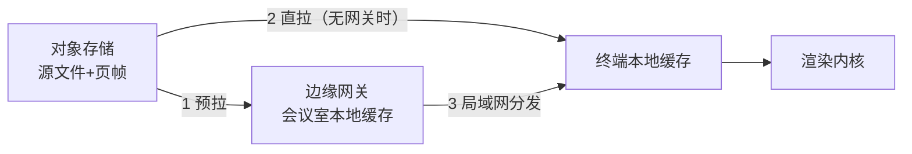

# 19 离线预下载与会议准备

## 19.1 为什么必须在会前下载

会议现场有三个物理事实无法改变：会议室带宽有限、开场前 10 分钟是并发高峰、部分会场根本断网。如果材料要等「点开才加载」，这三件事必然同时出问题。

| 现场事实 | 不做预下载的后果 |
| --- | --- |
| 一个会议室 100 台终端同时拉材料 | 出口带宽打满，首屏 30 秒以上 |
| 开会前 10 分钟集中入场 | 峰值并发是平时的 20 倍 |
| 保密会议室断网 / 弱网 | 材料打不开，会议开不下去 |
| 材料 300 页、含大图 | 单场流量可达数百 MB |

因此预下载不是「缓存优化」，而是**会议能否按时开始的前置条件**。平台把它当作一条独立链路设计：调度、分发、校验、加密、到期销毁，缺一环都不成立。

## 19.2 三个层次的缓存



| 层 | 容量 | 内容 | 命中收益 |
| --- | --- | --- | --- |
| 边缘网关 | 64–256 GB | 整个会议室当天的全部材料 | 100 台终端只拉 1 次公网 |
| 终端 | PC 2 GB / 平板 4 GB / 一体机 8 GB | 本人可见的材料页帧 + 待提交队列 | 断网可用 |
| 浏览器 | 50–200 MB（配额内） | 当前会议的页帧与文本层 | 网页端弱网可用 |

分层的意义是**把 N 份公网流量压成 1 份**。100 台终端、每场 200 MB，不设边缘缓存是 20 GB 出口流量；设了之后是 200 MB。

## 19.3 预下载触发与时机

预下载由「会议」驱动，不由「用户点开」驱动。

| 触发点 | 时间 | 内容 | 优先级 |
| --- | --- | --- | --- |
| 会议发布（READY） | T-24 小时 | 全部材料页帧、议程、参会名册 | 高 |
| 材料更新 | 变更即时 | 变更页帧 + 差异清单 | 高 |
| 会前提醒 | T-2 小时 | 补齐未完成项、录制模板、插件资源 | 中 |
| 入场签到 | T-15 分钟 | 首页 + 前 5 页 + 议程（快速首屏） | 最高 |
| 临时插入 | 会中 | 单页/单文件盲拉 | 最高 |

优先级的意义在于**带宽不足时先保什么**。正确顺序是：当前页 > 前后各 5 页 > 议程 > 全部材料 > 录制模板。

## 19.4 预下载策略的三种模式

不同客户对「提前把材料放到终端」的接受度差别很大，因为提前下载意味着材料离开服务端控制范围。平台提供三档，由租户策略决定。

| 模式 | 行为 | 适用 | 风险 |
| --- | --- | --- | --- |
| 服务端托管（默认） | 终端只缓存加密页帧，密钥会中下发，会后即失效 | 绝大多数场景 | 最低 |
| 会前预载 | T-24h 下发加密包，密钥 T-1h 下发，会后 2 小时销毁 | 断网会场、弱网会场 | 中 |
| 完全离线 | 加密包 + 离线密钥，有效期到会议结束 | 无网环境、外场 | 高，需审批 |

三档共用同一套包格式，区别只在**密钥下发时机**。这样终端不必为三种模式写三套逻辑。

## 19.5 加密包格式

预下载内容必须以「包」为单位，不能是散文件，否则无法校验、无法整体销毁。

| 组成 | 内容 |
| --- | --- |
| `manifest.json` | 会议 ID、材料清单、页数、每块哈希、总大小、版本、有效期 |
| `payload/` | 加密后的页帧（分块，默认 512 KB/块） |
| `index/` | 文本层与结构层（用于离线检索） |
| `meta/` | 议程、参会名册、水印模板 |
| `signature.sig` | 服务端私钥对 manifest 的签名 |

```json
{
  "meetingId": "m-8f21",
  "version": 3,
  "issuedAt": "2026-11-05T02:00:00Z",
  "expiresAt": "2026-11-06T02:00:00Z",
  "totalBytes": 214_958_080,
  "chunks": [
    { "id": "c-001", "materialId": "mat-77", "page": 1, "size": 524288, "sha256": "9f2c…" }
  ],
  "keyRef": "dek:dept-finance/2026-11",
  "signer": "kernel-signer-01"
}
```

校验分三步：验签 manifest → 逐块比对 sha256 → 校验块数与总大小。三步任一失败，整包作废并重新拉取，不做「部分可用」的妥协——部分可用的包在会议现场会造成最难排查的「有人能看有人不能看」。

## 19.6 断点续传与增量

| 机制 | 做法 |
| --- | --- |
| 分块 | 512 KB 固定块，按块独立校验 |
| 断点 | 记录已完成的块 ID 列表，续传只拉缺块 |
| 增量 | 材料更新只重拉变更页，manifest 带 `changedChunks` |
| 并发 | 单终端 4 并发，网关侧 8 并发 |
| 限速 | 默认单终端 2 MB/s，夜间窗口不限 |
| 重试 | 指数退避 3 次，失败标记为「待补」，会前 30 分钟再次尝试 |

增量下载是体验的关键：改一页只重拉一页，而不是重拉 200 MB。这要求页帧按「页」为不可变单元，改页即换哈希，未改页的哈希保持不变。

## 19.7 安全约束

预下载把材料「提前放到终端」，这是整个系统里风险最高的动作之一。必须五道锁。

| 锁 | 机制 |
| --- | --- |
| 设备绑定 | 包与设备指纹绑定，换设备即失效 |
| 时间锁 | 包有效期默认到会议结束后 2 小时，超时自动删除 |
| 密钥分离 | 包与会话密钥分离，密钥在会前 1 小时才下发 |
| 审批 | 「完全离线」模式需部门安全员审批，审批记录入链 |
| 销毁 | 会后终端执行删除并向服务端回执；未回执的设备列入异常清单 |

必须承认的边界：一旦密钥下发到终端，理论上终端管理员可以导出内容。因此平台对「完全离线」模式要求设备为受控设备（已加入 MDM 或已启用设备锁），并在合同中明确该模式的适用边界。

## 19.8 离线可用能力

预下载之后，离线状态下能做什么必须写清楚，避免客户误解。

| 能力 | 离线可用 | 说明 |
| --- | --- | --- |
| 浏览材料 | 是 | 已下载的页 |
| 批注与笔迹 | 是 | 本地队列，联网后按 opId 补传 |
| 翻页跟随 | 否 | 需要 rev，离线时停在本地页并提示 |
| 表决 | 否 | 需要服务端计票（可做「离线预投」但不计入正式结果） |
| 签到 | 是 | 本地记录，联网补传 |
| 检索 | 部分 | 仅限已下载的文本层 |
| 视频会议 | 否 | — |

「离线预投」是一个容易被误用的设计：离线投票只能作为意向收集，不能计入正式表决结果，否则无法保证一人一票与不可抵赖。

## 19.9 调度与带宽

| 项 | 策略 |
| --- | --- |
| 调度窗口 | 默认 22:00–07:00 全速，白天限速 30% |
| 并发任务 | 单租户同时 50 个预下载任务 |
| 优先级队列 | 按会议开始时间排序，最近的优先 |
| 回源 | 网关优先从同区域节点拉，跨区域回源需审批 |
| 失败重试 | 3 次退避后进入「待人工」队列并告警 |

## 19.10 容量测算

| 场景 | 单场材料 | 网关缓存 | 终端缓存 | 出口带宽（1 小时窗口） |
| --- | --- | --- | --- | --- |
| 部门周会 | 30 MB | 8 GB 足够 | 200 MB | 8 Mbps |
| 董事会 | 200 MB | 32 GB | 1 GB | 55 Mbps |
| 全员大会（200 终端） | 300 MB | 64 GB | 1.5 GB | 85 Mbps（含网关分发） |

测算口径：`出口带宽 = 单场材料 × 会议室数 / 分发窗口时长`，不含终端分发（走局域网）。

## 19.11 用户与管理端操作

| 角色 | 操作 |
| --- | --- |
| 主持人 | 一键「会前准备」：检查材料完整性、触发预载、查看各终端进度 |
| 参会人 | 会议卡片显示「已就绪 / 下载中 62% / 未下载」 |
| 管理员 | 设置预下载策略、审批离线模式、查看异常设备 |
| 实施 | 批量预载、导出就绪报告 |

「就绪报告」是实施验收的凭据：列出每个会议室每台终端的下载状态、校验结果、剩余空间。开会前拿这张表逐项核对，比现场试一遍可靠。

## 19.12 指标

| 指标 | 目标 |
| --- | --- |
| T-24h 预载完成率 | ≥ 95% |
| 会前 15 分钟就绪率 | 100%（未就绪即告警） |
| 首屏时间（预热后） | ≤ 300 ms |
| 增量下载占比 | ≥ 80% |
| 包校验失败率 | ≤ 0.5% |
| 会后销毁回执率 | ≥ 98% |

## 19.13 与会议状态机的集成

| 状态 | 预下载动作 |
| --- | --- |
| DRAFT | 不下载（材料还在改） |
| READY | 触发全量预载，终端显示「准备中」 |
| LIVE | 只做当前页预热与临时文件盲拉 |
| PAUSED | 继续补齐未完成项 |
| CLOSED | 停止下载，进入待销毁 |
| ARCHIVED | 执行销毁，回收空间 |

## 19.14 常见故障

| 现象 | 原因 | 处置 |
| --- | --- | --- |
| 部分终端一直 0% | 终端存储已满 / 时钟偏差导致签名校验失败 | 清缓存、校时、重试 |
| 下载完成但打不开 | 密钥未下发 / 密钥与包不匹配 | 检查 `keyRef` 与会话密钥 |
| 会前 10 分钟仍在下载 | 触发过晚 / 带宽不足 | 提前到 T-24h，扩容出口 |
| 增量下载变全量 | 页帧未按页做不可变单元 | 修转帧流水线 |
| 会后仍有残留 | 销毁任务失败 / 设备离线 | 列入异常清单，下次联网强制清理 |

最后一条最容易被忽略：**销毁不是「发个指令就算完」**，必须有回执。没有回执的销毁等于没销毁。

---

回到 `00_总纲与逐条核对.md` 复核覆盖度。

---

下一章：`20_多资源叠放与图层合成.md`
